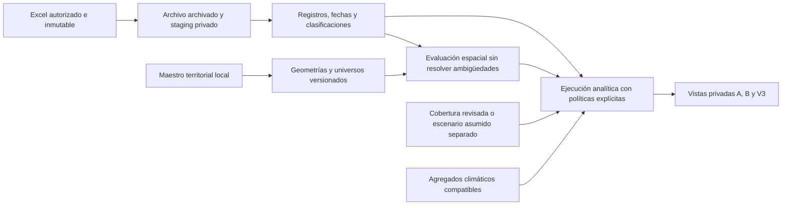

# Base epidemiológica privada

El circuito centraliza los registros fuente en PostgreSQL/PostGIS sin sustituir
ni ampliar la API pública. Reutiliza SQLAlchemy/psycopg2 y Alembic, con una
configuración de migraciones privada independiente de la historia pública.
El módulo Python está en `ml/src/sigard_ml/ingestion/epidemiology/`; no se importa
durante el arranque normal de FastAPI. No entrena ni carga estimadores.

## Capas

- `ingestion`: archivo original completo en `bytea`, SHA-256, hoja, columna,
  lote y fila tipada en JSONB. Las columnas desconocidas y fórmulas se preservan.
- `epidemiology`: registros fuente, observaciones de clasificación, reglas
  propuestas, fechas por tipo, políticas, relaciones de duplicación/revisión
  y evidencia de cobertura. Un registro no implica un episodio confirmado.
- `territory`: catálogos jerárquicos, domicilio, normalización observada,
  geocodificación, geometría versionada, candidatos y pertenencia a universos.
- `analytics`: calendario argentino, ejecuciones versionadas, fuentes
  seleccionadas, contexto derivado, clima y conteos materializados controlados.
  Las vistas ML son contratos candidatos, no fuentes activadas de los modelos.

La base de desarrollo propia usa exclusivamente loopback 55439 y un marcador
de clúster `sigard-epi-…`. No se accede a 5432, no se inicia Docker ni se
registran los procesos propios como un servicio. El directorio de datos queda
en el home Linux con permisos de propietario y se conserva al detenerlo.

Las tablas públicas `publication_batches` y `territorial_radios` son productos
de publicación con claves de lote, scores y atributos derivados. No son un
registro operacional de fuentes clínicas ni un maestro censal canónico. Por
eso no se usan como tablas padre de registros privados. La geometría canónica
privada se carga desde el maestro existente, conservando su hash, sin cambiar
el maestro ni las geometrías públicas. El despliegue compartido futuro requerirá
revisión explícita de cuentas y conexión; esta entrega no migra la base pública.

## Seguridad

Los esquemas privados revocan acceso a `PUBLIC`. El rol `sigard_epi_importer`
es NOLOGIN y permite importación; `sigard_epi_analytics_reader`, también
NOLOGIN, accede a analítica, sin acceso a domicilios, staging o coordenadas
individuales. El administrador crea cuentas separadas y otorga sólo el rol
necesario. Nunca usar el propietario/importador como cuenta de la API pública.
No se otorgan membresías a cuentas de esa API ni se añaden rutas sanitarias.

Las [revisiones deterministas](resolution-guide.md) se almacenan como anexos
inmutables a asignaciones, fechas, clasificaciones y fuentes. La versión guarda
la huella de los originales y cada ejecución analítica selecciona su revisión.
El lector analítico recibe la procedencia agregada, sin acceso a las revisiones
individuales. No se reemplazan las observaciones ni las geocodificaciones fuente.

URLs y contraseñas viven en archivos ignorados o en
`SIGARD_EPI_DATABASE_URL`. No se carga `.env` de la API, no se imprimen URLs,
errores SQL con parámetros ni valores de pacientes. Los reportes reales,
backups y exportaciones deben permanecer bajo `data/interim/official/` o
almacenamiento privado equivalente; nunca `frontend/public`.
