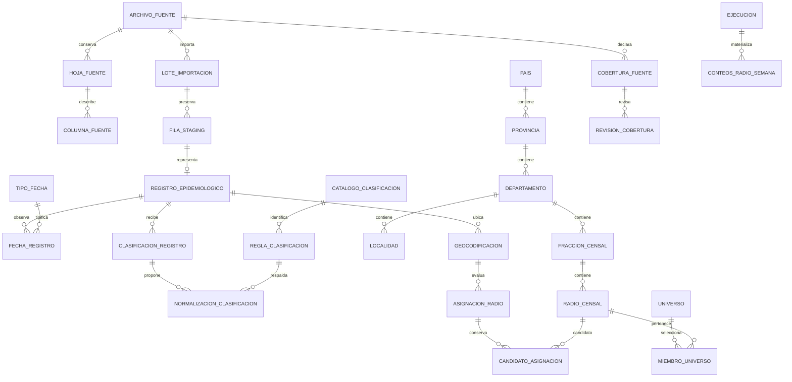
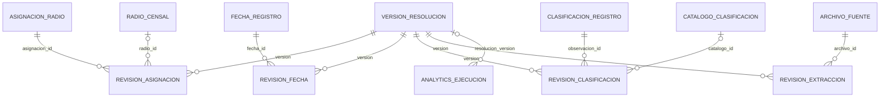
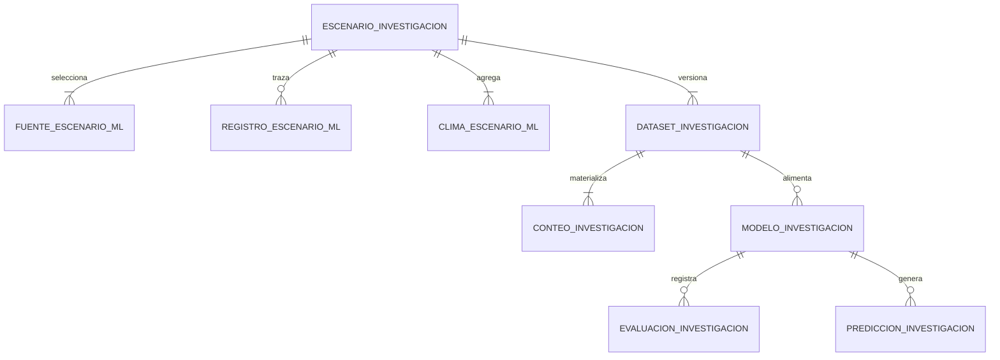

# Diagramas y relaciones

La [extensión predictiva e ingesta complementaria](predictive-ingestion.md)
incluye el DER y diccionario de las tablas aditivas epi09–epi11. Las relaciones
de esta página se conservan como base operacional de esa extensión.

## DER conceptual

Una fila tiene a lo sumo un registro normalizado; un evento externo puede
aparecer en varios registros. No se creó una entidad episodio sin evidencia.
Varias fechas y clasificaciones se representan como observaciones, no listas.
Una evaluación espacial puede conservar varios candidatos pero sólo permite
uno seleccionado en estados `unique_provisional`/`verified`; límites,
ambigüedades, coordenadas inválidas o revisión pendiente no se seleccionan.
Un universo selecciona radios canónicos sin copiarlos ni inferir equivalencias.
Una revisión de cobertura puede cambiar su estado conservando el historial.

## DER lógico con PK/FK

Las etiquetas de atributos identifican PK y FK. El historial interno de Alembic
se omite del DER de dominio. Las restricciones compuestas y CHECK completas
figuran en el diccionario y en las migraciones, incluidas las comprobaciones
de hoja/lote, columna/registro, SRID, versión espacial y selección diferida.

```mermaid
erDiagram
    ANALYTICS_CLIMA_SEMANA {
        text version PK
        bigint semana_id PK,FK
        double_precision temperatura
        double_precision humedad
        double_precision precipitacion
        timestamp_with_time_zone disponible_desde
        character fuente_sha256
        boolean compatible
    }
    ANALYTICS_CONTEOS_RADIO_SEMANA {
        bigint ejecucion_id PK,FK
        bigint radio_id PK,FK
        bigint semana_id PK,FK
        integer registros_observados
        integer cantidad_registros
        integer episodios_acreditados
        integer presencia
        integer pendientes_posibles
        integer fechas_aproximadas
        text cobertura_estado
        text estado_asignacion
        timestamp_with_time_zone ultimo_disponible
        boolean disponibilidad_verificada
        boolean ventana_parcial
    }
    ANALYTICS_CONTEXTO_RADIO {
        bigint universo_id PK,FK
        bigint radio_id PK,FK
        double_precision superficie_km2
        integer poblacion
        integer cantidad_vecinos
        character fuente_sha256
        timestamp_with_time_zone disponible_desde
    }
    ANALYTICS_EJECUCION {
        bigint id PK
        text version
        bigint universo_id FK
        bigint politica_temporal_id FK
        bigint politica_clasificacion_id FK
        bigint criterio_cobertura_id FK
        date inicio
        date fin
        text calendario_version
        text escenario
        boolean aceptar_geografia_provisional
        timestamp_with_time_zone corte_informacion
        text modo
        text clima_version
        boolean equivalencia_ml_verificada
        timestamp_with_time_zone creado_en
    }
    ANALYTICS_EXCLUSION_REGISTRO {
        bigint ejecucion_id PK,FK
        bigint registro_id PK,FK
        text motivo PK
    }
    ANALYTICS_FUENTE_EJECUCION {
        bigint ejecucion_id PK,FK
        bigint lote_id PK,FK
    }
    ANALYTICS_SEMANA_EPIDEMIOLOGICA {
        bigint id PK
        text calendario_version
        integer anio
        integer numero
        date inicio
        date fin
        integer semanas_anio
    }
    EPIDEMIOLOGY_CATALOGO_CLASIFICACION {
        bigint id PK
        text codigo
    }
    EPIDEMIOLOGY_CLASE_ADMITIDA {
        bigint politica_id PK,FK
        bigint catalogo_id PK,FK
    }
    EPIDEMIOLOGY_CLASIFICACION_REGISTRO {
        bigint id PK
        bigint registro_id FK
        bigint columna_id FK
        text valor_literal
        date fecha_revision
    }
    EPIDEMIOLOGY_COBERTURA_FUENTE {
        bigint id PK
        bigint archivo_id FK
        bigint universo_id FK
        bigint criterio_id FK
        date inicio
        date fin
    }
    EPIDEMIOLOGY_CRITERIO_COBERTURA {
        bigint id PK
        text version
        bigint politica_clasificacion_id FK
        text definicion_poblacion
        text filtro_extraccion
    }
    EPIDEMIOLOGY_FECHA_REGISTRO {
        bigint id PK
        bigint registro_id FK
        bigint tipo_id FK
        bigint columna_id FK
        date valor
        text estado
        text parser_version
    }
    EPIDEMIOLOGY_GRUPO_ETARIO {
        bigint id PK
        text literal
    }
    EPIDEMIOLOGY_INCIDENCIA_VALIDACION {
        bigint id PK
        bigint registro_id FK
        text codigo
        bigint columna_id FK
    }
    EPIDEMIOLOGY_NORMALIZACION_CLASIFICACION {
        bigint id PK
        bigint observacion_id FK
        bigint regla_id FK
        timestamp_with_time_zone aplicada_en
    }
    EPIDEMIOLOGY_POLITICA_CLASIFICACION {
        bigint id PK
        text version
        text definicion
    }
    EPIDEMIOLOGY_POLITICA_TEMPORAL {
        bigint id PK
        text version
        text descripcion
    }
    EPIDEMIOLOGY_PRIORIDAD_FECHA {
        bigint politica_id PK,FK
        bigint tipo_id PK,FK
        integer prioridad
    }
    EPIDEMIOLOGY_REGISTRO_EPIDEMIOLOGICO {
        bigint id PK
        bigint fila_id FK
        text identificador_externo
        bigint grupo_etario_id FK
        bigint domicilio_id FK
        text estado_normalizacion
        timestamp_with_time_zone disponible_desde
    }
    EPIDEMIOLOGY_REGLA_NORMALIZACION_CLASIFICACION {
        bigint id PK
        text version
        text literal_canonico
        bigint catalogo_id FK
        text estado_validacion
    }
    EPIDEMIOLOGY_RELACION_REGISTRO {
        bigint id PK
        bigint registro_id FK
        bigint otro_id FK
        text tipo
        text evidencia
        text revision_estado
    }
    EPIDEMIOLOGY_REVISION_COBERTURA {
        bigint id PK
        bigint cobertura_id FK
        text estado
        text evidencia
        text responsable
        timestamp_with_time_zone revisada_en
    }
    EPIDEMIOLOGY_TIPO_FECHA {
        bigint id PK
        text codigo
    }
    INGESTION_ARCHIVO_FUENTE {
        bigint id PK
        text nombre_original
        character sha256
        bigint bytes
        text periodo_declarado
        date fecha_extraccion
        text procedencia
        text entrega_version
        bytea contenido_original
    }
    INGESTION_COLUMNA_FUENTE {
        bigint id PK
        bigint hoja_id FK
        integer ordinal
        text nombre_original
        text campo_propuesto
    }
    INGESTION_FILA_STAGING {
        bigint id PK
        bigint lote_id FK
        bigint hoja_id FK
        integer numero_fila
        jsonb contenido
        character sha256
        text estado
    }
    INGESTION_HOJA_FUENTE {
        bigint id PK
        bigint archivo_id FK
        integer ordinal
        text nombre
        integer fila_encabezado
        character layout_sha256
        jsonb preambulo
    }
    INGESTION_LOTE_IMPORTACION {
        bigint id PK
        bigint archivo_id FK
        text importador_version
        timestamp_with_time_zone creado_en
        text estado
        integer filas_leidas
        integer filas_normalizadas
        integer filas_parciales
        jsonb validacion
    }
    TERRITORY_ASIGNACION_RADIO {
        bigint id PK
        bigint geocodificacion_id FK
        bigint version_geometria_id FK
        text estado
        text evidencia
    }
    TERRITORY_CANDIDATO_ASIGNACION {
        bigint asignacion_id PK,FK
        bigint radio_id PK,FK
        text predicado
        boolean seleccionado
    }
    TERRITORY_CONTEXTO_CENSAL {
        bigint radio_id PK,FK
        text version PK,FK
        integer poblacion
    }
    TERRITORY_DEPARTAMENTO {
        bigint id PK
        bigint provincia_id FK
        text nombre
        text codigo
    }
    TERRITORY_DOMICILIO {
        bigint id PK
        bigint localidad_id FK
        text calle_original
        text numero_original
    }
    TERRITORY_FRACCION_CENSAL {
        bigint id PK
        bigint departamento_id FK
        text codigo
    }
    TERRITORY_GEOCODIFICACION {
        bigint id PK
        bigint registro_id FK
        bigint proceso_id FK
        geometry geom
        text estado
        text precision_literal
        text confianza
        boolean requiere_revision
        text crs_estado
        text radio_declarado
        text fraccion_declarada
    }
    TERRITORY_LOCALIDAD {
        bigint id PK
        bigint departamento_id FK
        text nombre
        text codigo
    }
    TERRITORY_MIEMBRO_UNIVERSO {
        bigint universo_id PK,FK
        bigint radio_id PK,FK
    }
    TERRITORY_NORMALIZACION_DOMICILIO {
        bigint id PK
        bigint domicilio_id FK
        text version
        text direccion_normalizada
        text calle_oficial
        text calle_codigo
        text estado
    }
    TERRITORY_PAIS {
        bigint id PK
        text nombre
        text codigo
    }
    TERRITORY_PROCESO_GEOCODIFICACION {
        bigint id PK
        text proveedor
        text metodo
        text version
    }
    TERRITORY_PROVINCIA {
        bigint id PK
        bigint pais_id FK
        text nombre
        text codigo
    }
    TERRITORY_RADIO_CENSAL {
        bigint id PK
        bigint fraccion_id FK
        bigint version_geometria_id FK
        text codigo
        geometry geom
    }
    TERRITORY_UNIVERSO {
        bigint id PK
        text version
        text descripcion
    }
    TERRITORY_VECINDAD {
        bigint radio_id PK,FK
        bigint vecino_id PK,FK
        text regla_version PK
    }
    TERRITORY_VERSION_CONTEXTO_CENSAL {
        text version PK
        character fuente_sha256
    }
    TERRITORY_VERSION_GEOMETRIA {
        bigint id PK
        text version
        character fuente_sha256
        text crs
    }
    ANALYTICS_SEMANA_EPIDEMIOLOGICA ||--o{ ANALYTICS_CLIMA_SEMANA : semana_id
    ANALYTICS_SEMANA_EPIDEMIOLOGICA ||--o{ ANALYTICS_CONTEOS_RADIO_SEMANA : semana_id
    TERRITORY_RADIO_CENSAL ||--o{ ANALYTICS_CONTEOS_RADIO_SEMANA : radio_id
    ANALYTICS_EJECUCION ||--o{ ANALYTICS_CONTEOS_RADIO_SEMANA : ejecucion_id
    TERRITORY_MIEMBRO_UNIVERSO ||--o{ ANALYTICS_CONTEXTO_RADIO : universo_id
    TERRITORY_MIEMBRO_UNIVERSO ||--o{ ANALYTICS_CONTEXTO_RADIO : radio_id
    TERRITORY_RADIO_CENSAL ||--o{ ANALYTICS_CONTEXTO_RADIO : radio_id
    TERRITORY_UNIVERSO ||--o{ ANALYTICS_CONTEXTO_RADIO : universo_id
    EPIDEMIOLOGY_CRITERIO_COBERTURA ||--o{ ANALYTICS_EJECUCION : criterio_cobertura_id
    TERRITORY_UNIVERSO ||--o{ ANALYTICS_EJECUCION : universo_id
    EPIDEMIOLOGY_POLITICA_TEMPORAL ||--o{ ANALYTICS_EJECUCION : politica_temporal_id
    EPIDEMIOLOGY_POLITICA_CLASIFICACION ||--o{ ANALYTICS_EJECUCION : politica_clasificacion_id
    EPIDEMIOLOGY_REGISTRO_EPIDEMIOLOGICO ||--o{ ANALYTICS_EXCLUSION_REGISTRO : registro_id
    ANALYTICS_EJECUCION ||--o{ ANALYTICS_EXCLUSION_REGISTRO : ejecucion_id
    ANALYTICS_EJECUCION ||--o{ ANALYTICS_FUENTE_EJECUCION : ejecucion_id
    INGESTION_LOTE_IMPORTACION ||--o{ ANALYTICS_FUENTE_EJECUCION : lote_id
    EPIDEMIOLOGY_POLITICA_CLASIFICACION ||--o{ EPIDEMIOLOGY_CLASE_ADMITIDA : politica_id
    EPIDEMIOLOGY_CATALOGO_CLASIFICACION ||--o{ EPIDEMIOLOGY_CLASE_ADMITIDA : catalogo_id
    INGESTION_COLUMNA_FUENTE ||--o{ EPIDEMIOLOGY_CLASIFICACION_REGISTRO : columna_id
    EPIDEMIOLOGY_REGISTRO_EPIDEMIOLOGICO ||--o{ EPIDEMIOLOGY_CLASIFICACION_REGISTRO : registro_id
    INGESTION_ARCHIVO_FUENTE ||--o{ EPIDEMIOLOGY_COBERTURA_FUENTE : archivo_id
    TERRITORY_UNIVERSO ||--o{ EPIDEMIOLOGY_COBERTURA_FUENTE : universo_id
    EPIDEMIOLOGY_CRITERIO_COBERTURA ||--o{ EPIDEMIOLOGY_COBERTURA_FUENTE : criterio_id
    EPIDEMIOLOGY_POLITICA_CLASIFICACION ||--o{ EPIDEMIOLOGY_CRITERIO_COBERTURA : politica_clasificacion_id
    EPIDEMIOLOGY_REGISTRO_EPIDEMIOLOGICO ||--o{ EPIDEMIOLOGY_FECHA_REGISTRO : registro_id
    INGESTION_COLUMNA_FUENTE ||--o{ EPIDEMIOLOGY_FECHA_REGISTRO : columna_id
    EPIDEMIOLOGY_TIPO_FECHA ||--o{ EPIDEMIOLOGY_FECHA_REGISTRO : tipo_id
    EPIDEMIOLOGY_REGISTRO_EPIDEMIOLOGICO ||--o{ EPIDEMIOLOGY_INCIDENCIA_VALIDACION : registro_id
    INGESTION_COLUMNA_FUENTE o|--o{ EPIDEMIOLOGY_INCIDENCIA_VALIDACION : columna_id
    EPIDEMIOLOGY_REGLA_NORMALIZACION_CLASIFICACION ||--o{ EPIDEMIOLOGY_NORMALIZACION_CLASIFICACION : regla_id
    EPIDEMIOLOGY_CLASIFICACION_REGISTRO ||--o{ EPIDEMIOLOGY_NORMALIZACION_CLASIFICACION : observacion_id
    EPIDEMIOLOGY_POLITICA_TEMPORAL ||--o{ EPIDEMIOLOGY_PRIORIDAD_FECHA : politica_id
    EPIDEMIOLOGY_TIPO_FECHA ||--o{ EPIDEMIOLOGY_PRIORIDAD_FECHA : tipo_id
    INGESTION_FILA_STAGING ||--o| EPIDEMIOLOGY_REGISTRO_EPIDEMIOLOGICO : fila_id
    TERRITORY_DOMICILIO o|--o{ EPIDEMIOLOGY_REGISTRO_EPIDEMIOLOGICO : domicilio_id
    EPIDEMIOLOGY_GRUPO_ETARIO o|--o{ EPIDEMIOLOGY_REGISTRO_EPIDEMIOLOGICO : grupo_etario_id
    EPIDEMIOLOGY_CATALOGO_CLASIFICACION ||--o{ EPIDEMIOLOGY_REGLA_NORMALIZACION_CLASIFICACION : catalogo_id
    EPIDEMIOLOGY_REGISTRO_EPIDEMIOLOGICO ||--o{ EPIDEMIOLOGY_RELACION_REGISTRO : registro_id
    EPIDEMIOLOGY_REGISTRO_EPIDEMIOLOGICO ||--o{ EPIDEMIOLOGY_RELACION_REGISTRO : otro_id
    EPIDEMIOLOGY_COBERTURA_FUENTE ||--o{ EPIDEMIOLOGY_REVISION_COBERTURA : cobertura_id
    INGESTION_HOJA_FUENTE ||--o{ INGESTION_COLUMNA_FUENTE : hoja_id
    INGESTION_HOJA_FUENTE ||--o{ INGESTION_FILA_STAGING : hoja_id
    INGESTION_LOTE_IMPORTACION ||--o{ INGESTION_FILA_STAGING : lote_id
    INGESTION_ARCHIVO_FUENTE ||--o{ INGESTION_HOJA_FUENTE : archivo_id
    INGESTION_ARCHIVO_FUENTE ||--o{ INGESTION_LOTE_IMPORTACION : archivo_id
    TERRITORY_GEOCODIFICACION ||--o{ TERRITORY_ASIGNACION_RADIO : geocodificacion_id
    TERRITORY_VERSION_GEOMETRIA ||--o{ TERRITORY_ASIGNACION_RADIO : version_geometria_id
    TERRITORY_ASIGNACION_RADIO ||--o{ TERRITORY_CANDIDATO_ASIGNACION : asignacion_id
    TERRITORY_RADIO_CENSAL ||--o{ TERRITORY_CANDIDATO_ASIGNACION : radio_id
    TERRITORY_VERSION_CONTEXTO_CENSAL ||--o{ TERRITORY_CONTEXTO_CENSAL : version
    TERRITORY_RADIO_CENSAL ||--o{ TERRITORY_CONTEXTO_CENSAL : radio_id
    TERRITORY_PROVINCIA ||--o{ TERRITORY_DEPARTAMENTO : provincia_id
    TERRITORY_LOCALIDAD o|--o{ TERRITORY_DOMICILIO : localidad_id
    TERRITORY_DEPARTAMENTO ||--o{ TERRITORY_FRACCION_CENSAL : departamento_id
    TERRITORY_PROCESO_GEOCODIFICACION ||--o{ TERRITORY_GEOCODIFICACION : proceso_id
    EPIDEMIOLOGY_REGISTRO_EPIDEMIOLOGICO ||--o{ TERRITORY_GEOCODIFICACION : registro_id
    TERRITORY_DEPARTAMENTO ||--o{ TERRITORY_LOCALIDAD : departamento_id
    TERRITORY_RADIO_CENSAL ||--o{ TERRITORY_MIEMBRO_UNIVERSO : radio_id
    TERRITORY_UNIVERSO ||--o{ TERRITORY_MIEMBRO_UNIVERSO : universo_id
    TERRITORY_DOMICILIO ||--o{ TERRITORY_NORMALIZACION_DOMICILIO : domicilio_id
    TERRITORY_PAIS ||--o{ TERRITORY_PROVINCIA : pais_id
    TERRITORY_VERSION_GEOMETRIA ||--o{ TERRITORY_RADIO_CENSAL : version_geometria_id
    TERRITORY_FRACCION_CENSAL ||--o{ TERRITORY_RADIO_CENSAL : fraccion_id
    TERRITORY_RADIO_CENSAL ||--o{ TERRITORY_VECINDAD : radio_id
    TERRITORY_RADIO_CENSAL ||--o{ TERRITORY_VECINDAD : vecino_id
```

La cardinalidad del DER lógico se deriva de FK, nulabilidad y unicidad simple;
las claves compuestas requieren leer conjuntamente sus atributos.

## Anexo inmutable de resoluciones (`epi08`)

Cada revisión tiene PK compuesta por versión y observación padre. La ejecución
selecciona una versión nullable; las anteriores no cambian. Los anexos no
sustituyen observaciones ni acreditan episodios. Véase el
[contrato de resolución](resolution-guide.md).
# Extensión de investigación Option B

El [contrato nuevo](option-b-research.md) conserva los anteriores y añade una
línea de procedencia y registro independiente, dentro de la misma base:

Las selecciones referencian registros/asignaciones originales, sin copiar sus
datos personales. Los conteos y predicciones referencian radios del maestro.
La política conservadora y el registro principal anterior no se modifican.
