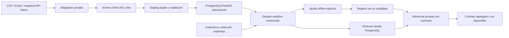

# Componente predictivo principal desde PostgreSQL/PostGIS

El [contrato posterior de investigación Option B](option-b-research.md) registra
nuevos A/B/V3 en tablas separadas. No altera este candidato, sus resultados,
su protección de versión única ni su estado `candidate_failed`.

Entrega técnica del 29/10/2026. La comparación real y el inventario completo
están en `data/interim/official/predictive-consolidation-20261029-v1/`,
excluidos de Git. **El candidato no cumplió el criterio frente a persistencia;
no hay un modelo promovido ni una aprobación académica.**

El anteproyecto original citado en `PRODUCT.md` apunta a otro equipo; no se
localizó una copia ni observaciones originales del tutor en el repositorio.
Esta entrega utiliza los requisitos explícitos de la solicitud y los contratos
locales. No sustituye la revisión del tutor ni modifica otros módulos.

## Problema y resolución

Unidad: residencia declarada en la localidad La Rioja, departamento Capital,
provincia La Rioja, por semana epidemiológica argentina. Horizonte: t+1.
Objetivo: cantidad de **registros fuente confirmados elegibles**, con referencia
clínica fechada y sin relaciones de identidad/revisión pendientes.
La fecha es inicio de síntomas; si falta, toma de muestra registrada, identificada
como proxy. No se reemplaza por notificación, extracción o año del archivo.
No son episodios acreditados, infecciones ocurridas en esa semana ni incidencia.

Se conserva la revisión de clasificación existente. Un literal desconocido o
contradictorio queda excluido; 2022 permanece separado. Los identificadores
repetidos pendientes no se fusionan ni se reparten entre train y evaluación.
Cada inclusión y exclusión queda vinculada al registro y lote originales en
`analytics.seleccion_registro_predictivo`, accesible sólo al importador.

La unidad por radio no resulta defendible con las precisiones fuente actuales.
La sensibilidad contrasta todos los puntos candidatos con el subconjunto
provisional; agrupar por fracción no acredita un límite de error que las fuentes
no proporcionan. El candidato usa la residencia declarada en Capital y es
invariante a reasignar sus puntos entre radios. **No identifica zonas internas
prioritarias.** No se fabrican objetivos territoriales ni se reparte el total.

## Fuentes, alcance y faltantes

El inventario recorre archivos regulares de `data/` y código, contratos y
artefactos de `ml/`, omitiendo entornos, caches y sus propias salidas. Registra
SHA-256, esquema, filas, faltantes, períodos, duplicados de contenido, condición
original/derivada y vínculo con PostgreSQL. Los Excel ya importados se describen
desde staging tipado archivado; no se vuelven a abrir. Los modelos históricos
se registran por huella y manifiestos, sin deserializarlos para exploración.
Los componentes SHP/DBF/SHX se reconocen como un único dataset.

Se incorporan clima diario Open-Meteo y agregados censales y públicos de Capital.
La cartografía nacional y los catálogos de otras localidades no añaden etiquetas
del objetivo. Se reutilizan los radios, población, superficies y vecindades ya
persistidos, sin cambiar geometrías. Los CSV públicos de dengue quedan separados
de SISA: distintas extracciones/poblaciones y potencial solapamiento; nunca se
suman ni se usan como predicciones observadas. Las simulaciones y resultados
anteriores sólo son antecedentes congelados.

Dos columnas conservan las interpretaciones del objetivo:

- `conteo_conservador`: NULL, porque no se acreditó vigilancia completa de Capital.
- `conteo_experimental`: subtotal del snapshot **exactamente filtrado** en las
  semanas explícitas del escenario; cero allí sólo significa ausencia de registro
  elegible bajo ese supuesto. Fuera de esas semanas permanece NULL.

El escenario acota cada año al soporte observado de los registros elegibles;
su lista completa se fija antes del ajuste. El intervalo no demuestra cobertura.
Los registros sin fecha permanecen preservados y contabilizados como pendientes;
no se distribuyen por semanas ni se cuentan como ausencia de enfermedad.
Este estimando filtrado es distinto del conteo completo conservador y de las
etiquetas espaciales V3 anteriores. No se levantan sus máscaras.

## Predictores y disponibilidad

Se utilizan conteo en t, t−1 y t−2, media de tres cierres y cambio reciente;
temperatura media, humedad y precipitación en t; temperatura media y precipitación
acumulada de cuatro semanas; seno/coseno estacional según el calendario
`ar-snvs-2020-2026-v1`.

No se saltan huecos ni años al construir antecedentes epidemiológicos. Se exigen
tres conteos consecutivos dentro de cobertura y clima completo en origen. Una
semana climática requiere siete días. Ventanas de cuatro semanas incompletas
siguen NaN, admitidos por el estimador. No hay imputación de objetivos o conteos.
Las coordenadas, identidad, objetivo futuro y resultados de otros modelos no son
features. Población, densidad, superficie y vecindad se conservan en PostgreSQL,
pero no discriminan dentro de una única unidad territorial; se excluyen del ajuste.
Edad y clasificaciones futuras tampoco se convierten en predictores retrospectivos.

El clima local es un producto histórico exportado; no se acreditaron producto,
hora de disponibilidad ni latencia operativa. Su uso es reconstrucción
retrospectiva. La extracción final de SISA tampoco acredita llegada en origen.
No se denomina al estudio backtest operativo o prueba prospectiva.

## Estrategia única y protocolo previo

Se reutiliza exclusivamente el regresor Poisson directo de V3
(`forecasting.v3._regressor`), con sus parámetros fijos: 100 iteraciones,
7 hojas, mínimo 20 muestras por hoja, regularización L2=5, tasa=.05,
sin early stopping aleatorio, semilla 20261021. No se ejecuta la búsqueda
de tres candidatos de V3 ni una clasificación de presencia paralela.

Baseline principal: último conteo semanal cerrado realmente conocido en t.
Referencia secundaria: media del entrenamiento anterior al bloque evaluado.
La información del origen es idéntica para modelo y persistencia. MAE es la
métrica principal; RMSE y sesgo medio son complementarias. Se informa también
desviancia Poisson cuando está definida, sin seleccionar con ella.

El criterio provisional fijado antes de entrenar exige reducción de MAE ≥5 %,
RMSE no mayor al de persistencia y límite superior del intervalo descriptivo
pareado de diferencia MAE <0, con al menos 12 semanas comparadas. El 5 % no
constituye un umbral aprobado por el tutor ni una validación sanitaria.

Desarrollo: historia 2020/2021/2023, bloques de evaluación 2021 y 2023 cuando
el entrenamiento anterior alcanza 18 etiquetas maduras. Comparación: bloque
2024 con modelo fijo ajustado sólo hasta 2023. En cada bloque se exige
`train.target_end < first_validation_origin`; filas de una misma semana no se
separan aleatoriamente. Se conserva cualquier bloque no soportado como tal.
No se eligen hiperparámetros con 2024, período ya examinado en trabajos anteriores.

Incertidumbre: bootstrap pareado por bloques contiguos de tres semanas, sin
cruzar años o discontinuidades, 1.000 remuestreos deterministas. Describe esta
muestra condicionada; no es un intervalo predictivo ni evidencia externa.

La comparación se cerró antes del ajuste final con todo el historial elegible.
Ese ajuste final no es una nueva evaluación. Se guarda un artefacto lógico único
en PostgreSQL, con copia privada de respaldo byte a byte, versión de dataset,
matriz de ajuste, variables, parámetros, código y métricas. El estado
`candidate_failed` impide ofrecer sus cantidades como predicciones disponibles.

## Flujo del componente



El entrenamiento y las consultas usan tablas PostgreSQL, no CSV/Excel/Parquet.
La [capa compartida de acceso ML](postgres-ml-migration.md) centraliza ahora la
lectura semanal sin cambiar esta consulta, las variables ni el candidato.
Estos formatos quedan como entradas, respaldo y salidas. Ni importación ni
actualización de materializaciones ejecutan entrenamiento. No hay endpoints
públicos nuevos, procesos de inferencia en el arranque normal ni cambios del mapa.

## Contrato de consulta y mapa

`core_model.infer(conn, model_version=..., origin=..., mode=...)` exige una
versión explícita. Devuelve un objeto agregado con:

- `status`, `reasons`, `model_version`, `dataset_version`, `validation_state`.
- `origin_week`, `target_week`, `horizon_weeks=1` y `retrospective`.
- `spatial_unit=capital_source_residence`, `unit_code=capital`, `target`.
- `expected_count`, `relative_activity`, `probability`, `alerts_enabled=false`.

Una incompatibilidad de contrato/versión de sklearn, modelo ajustado después
del origen, lote retirado, features fundamentales ausentes o rechazo frente al
baseline devuelve `prediction_unavailable` y cantidad NULL. En modo operativo
se revisan llegada antes del cierre y clima, y se conserva desactivado el uso
productivo del candidato retrospectivo. Las respuestas se registran en la base.

No se requiere conocer el objetivo futuro para construir X. No se suministran
valores actuales ficticios. Con la única unidad actual, `relative_activity` y
`probability` quedan NULL. Para una futura zonificación respaldada, una cuota
relativa `mu_z / sum(mu_z)` sólo tendría sentido sobre el universo completo
compatible, denominador positivo y salidas disponibles; expresaría composición
esperada de registros, no probabilidad individual ni umbral de brote. Esa
transformación no está habilitada en esta entrega.

## Operación y pruebas

Entrada única del CLI privado:

```powershell
.\ml\venv\Scripts\python.exe -B -m sigard_ml.forecasting.core_pipeline ACCION --connection RUTA_CONNECTION_PRIVADA --config RUTA_CONTRATO_PRIVADO --report NUEVO_INFORME_PRIVADO
```

Acciones: `inventory`, `prepare`, `propose-coverage`, `materialize`, `train`,
`infer`. `prepare` aplica migraciones aditivas e ingiere sólo complementos
seleccionados por hash; no repite los cinco Excel. `propose-coverage` no acredita
cobertura ni cambia tablas. Materializar exige adoptar una lista explícita.
`train` rechaza otro candidato existente, no sobrescribe modelos y fija el
protocolo antes del ajuste. `infer` añade `--origin AAAA-MM-DD` y opcionalmente
`--mode retrospective`. No ejecutar `train` para preparar una presentación.

La conexión utiliza la configuración privada existente del clúster WSL 55439.
No se crea otra base, no se accede a 5432 ni se utiliza Docker. Las pruebas
PostGIS usan exclusivamente la base de pruebas **ya existente**, verifican su
nombre/marcador y recrean sólo allí los esquemas con datos ficticios. Las pruebas
de reconstrucción y entrenamiento bloquean los lectores tabulares tras la carga.
La serialización se comprueba por hash y predicciones idénticas al restaurar.

El lector analítico no recibe staging, domicilios, puntos ni selecciones de
registros individuales. El artefacto serializado sólo se deserializa desde el
registro privado controlado, comprobando su SHA-256; nunca desde un archivo
arbitrario enviado por un usuario. Separar credenciales reales por rol continúa
siendo una tarea del operador; no se crean cuentas de API en esta entrega.

## Referencias de implementación

- [HistGradientBoostingRegressor](https://scikit-learn.org/stable/modules/generated/sklearn.ensemble.HistGradientBoostingRegressor.html): pérdida Poisson y faltantes nativos; las versiones efectivas están en el protocolo privado.
- [Prevención de filtración](https://scikit-learn.org/stable/common_pitfalls.html): separar antes de ajustar transformaciones.
- Kassis, T., Agarwal, V., He, Y., Patel, D. y Brueckner, A. M. (2026). [Scientific Agent Skills: A Library of Procedural Knowledge for Research Agents](https://doi.org/10.48550/arXiv.2609.00065). Procedimientos de apoyo consultados; no aval académico de SIGARD.

Informe elaborado con asistencia de Codex; revisión humana y aceptación del
tutor pendientes. No es un manuscrito listo para envío ni una certificación.
