# Extensión normalizada e ingesta reutilizable del componente predictivo

Las migraciones `20261029_epi09`–`epi11` añaden entidades a la misma base
privada. Los esquemas, registros, vistas A/B/V3, geometrías y ejecuciones
anteriores se conservan. [Contrato predictivo](predictive-core.md).

## DER de la extensión

```mermaid
erDiagram
    ARCHIVO_FUENTE ||--o{ LOTE_COMPLEMENTARIO : origina
    LOTE_COMPLEMENTARIO ||--o{ ESTADO_LOTE_COMPLEMENTARIO : historiza
    LOTE_COMPLEMENTARIO ||--o{ FILA_COMPLEMENTARIA : preserva
    LOTE_COMPLEMENTARIO ||--o{ CLIMA_DIARIO : normaliza
    ESTACION_CLIMATICA ||--o{ CLIMA_DIARIO : referencia
    LOTE_COMPLEMENTARIO ||--o{ AGREGADO_PUBLICO : normaliza
    DEPARTAMENTO ||--o{ AGREGADO_PUBLICO : localiza
    SEMANA_EPIDEMIOLOGICA ||--o{ AGREGADO_PUBLICO : fecha
    EVENTO_AGREGADO ||--o{ AGREGADO_PUBLICO : clasifica
    GRUPO_ETARIO ||--o{ AGREGADO_PUBLICO : agrupa
    LOTE_COMPLEMENTARIO ||--o{ OBSERVACION_CENSAL : normaliza
    RADIO_CENSAL ||--o{ OBSERVACION_CENSAL : referencia
    VARIABLE_CENSAL ||--o{ CATEGORIA_CENSAL : define
    CATEGORIA_CENSAL ||--o{ OBSERVACION_CENSAL : mide
    LOTE_IMPORTACION ||--o{ ESTADO_LOTE_SISA : historiza
    DATASET_PREDICTIVO ||--o{ FUENTE_DATASET_PREDICTIVO : selecciona
    LOTE_IMPORTACION ||--o{ FUENTE_DATASET_PREDICTIVO : participa
    DATASET_PREDICTIVO ||--o{ COMPLEMENTO_DATASET_PREDICTIVO : selecciona
    LOTE_COMPLEMENTARIO ||--o{ COMPLEMENTO_DATASET_PREDICTIVO : participa
    DATASET_PREDICTIVO ||--o{ SELECCION_REGISTRO_PREDICTIVO : explica
    REGISTRO_EPIDEMIOLOGICO ||--o{ SELECCION_REGISTRO_PREDICTIVO : conserva
    DATASET_PREDICTIVO ||--o{ SERIE_PREDICTIVA : materializa
    DATASET_PREDICTIVO ||--o{ CLIMA_PREDICTIVO : agrega
    SEMANA_EPIDEMIOLOGICA ||--o{ SERIE_PREDICTIVA : fecha
    SEMANA_EPIDEMIOLOGICA ||--o{ CLIMA_PREDICTIVO : fecha
    DATASET_PREDICTIVO ||--o{ MODELO_PREDICTIVO : respalda
    MODELO_PREDICTIVO ||--o{ PREDICCION_PREDICTIVA : registra
```

`intento_complementario` registra éxitos, reutilizaciones y fallos por hash,
adaptador y versión, sin volcar datos o excepciones SQL sensibles. Una falla
revierte la transacción de normalización y después guarda su recibo separado.
`error_complementario` reserva códigos por fila para adaptadores con diagnósticos
múltiples; los adaptadores actuales rechazan dominios inválidos del lote completo.

## Diccionario y claves

- `lote_complementario`: PK id; UNIQUE archivo/adaptador/versión; filas fuente
  y aceptadas, contrato/procedencia. FK a bytes originales con SHA-256.
- `fila_complementaria`: PK lote/ordinal; JSONB tipado de staging y SHA-256.
  Para lotes anteriores a epi10, se reconstruyó desde las filas normalizadas
  ya persistidas, sin reabrir archivos; no se presenta como staging original.
- `estado_lote_complementario`, `estado_lote_sisa`: PK evento; FK lote;
  accepted/withdrawn, motivo y fecha. La vista vigente selecciona el último
  evento; los lotes SISA completos anteriores se consideran aceptados por defecto.
- `estacion_climatica`: PK id y código único; punto **público** de referencia
  del producto exportado y zona horaria. No es un punto de un paciente ni
  prueba de una estación física observacional.
- `clima_diario`: PK lote/estación/fecha; temperaturas mínima/media/máxima en
  °C, humedad en %, precipitación en mm, disponibilidad temporal nullable.
- `agregado_publico`: PK lote/departamento/semana/evento/grupo etario;
  cantidad entera no negativa. Catálogos separados, sin listas en columnas.
- `variable_censal`, `categoria_censal`: variable única; categoría única
  dentro de variable y descripción. `observacion_censal`: PK lote/radio/categoría;
  cantidad no negativa. La clave de radio se compara exactamente, conservando ceros.
- `dataset_predictivo`: PK versión, contrato, SHA-256 de entrada, calendario,
  revisión y unidad. Las fuentes y complementos son relaciones FK explícitas.
- `seleccion_registro_predictivo`: PK dataset/registro; incluido y motivo.
  Nunca contiene una nueva identidad de episodio.
- `serie_predictiva`: PK dataset/semana/unidad; subtotal observado, conteos
  conservador/experimental separados, cobertura, proxies de muestra,
  pendientes de fecha y disponibilidad.
- `clima_predictivo`: PK dataset/semana; promedios/sumas versionados y cantidad
  de días; menos de siete días impide publicar agregados completos.
- `modelo_predictivo`: versión única y componente principal único, dataset FK,
  artefacto BYTEA/hash, protocolo, metadatos y métricas. Estados candidatos;
  el CHECK impide active en esta entrega. No altera registros A/B/V1/V2/V3.
- `prediccion_predictiva`: PK id, modelo FK, origen, modo y respuesta agregada.

Las entidades operacionales conservan claves y catálogos normalizados. Las
series, matrices, metadatos y métricas pertenecen a la capa analítica versionada;
no se utilizan sus JSONB para reemplazar tablas operacionales de dominio.
Los snapshots, observaciones y estados nuevos rechazan UPDATE/DELETE mediante
triggers. No se habilita downgrade destructivo.

## Servicios y flujo futuro

`sigard_ml.ingestion.epidemiology.complementary` define el protocolo
`Adapter.read(bytes) -> Adapted(kind, frame, source_rows, contract)`. Los
adaptadores actuales son CSV diario Open-Meteo, agregado público de dengue y
agregados censales. El importador epidemiológico Excel existente conserva su
normalización transaccional. Un adaptador clínico CSV o un cliente API futuro
debe implementar el mismo límite y reutilizar la normalización de dominio;
no se ha implementado un cliente de red ni un endpoint de cargas.

Flujo: validar autorización/hash y versión; comprobar idempotencia; parsear
sin ejecutar fórmulas/macros; validar estructura, tipos, duplicados y rangos;
archivar fuente; insertar lote, staging y entidades en una transacción;
registrar aceptación; materializar una versión analítica explícita; consultar
compatibilidad y disponibilidad para inferencia. Los datos fuera del universo
seleccionado se contabilizan aparte y permanecen recuperables del archivo
archivado. No se reinterpretan ni se duplican como observaciones de Capital.

Una entrada idéntica con el mismo adaptador/versión retorna `already_imported`.
Una fuente o transformación cambiada necesita otra versión. El procesamiento
incremental es por lotes inmutables y claves de observación, no por sumar
snapshots solapados: cada materialización selecciona explícitamente los lotes
que representan su población/revisión. El importador no selecciona por
conveniencia el último fichero ni resuelve revisiones clínicas automáticamente.

`withdraw` y `withdraw_sisa` registran retiro lógico con motivo obligatorio.
Las filas históricas y los snapshots científicos se preservan; las vistas de
lotes vigentes impiden reconstruir/inferir silenciosamente sobre un lote retirado.
No se retiran lotes reales como prueba: la reversión se verifica con fixtures.
La selección de lotes de una nueva entrega y sus semanas de cobertura debe
seguir un contrato revisado; una carga no acredita cobertura ni cambia el modelo.

El rol importador escribe lotes y materializaciones. El lector accede a series,
artefacto registrado y respuestas agregadas; no a staging, domicilios o selección
individual. No se cambian membresías ni credenciales de la API pública. Un futuro
servicio de ingesta deberá agregar autenticación/autorización antes de exponer
operaciones, fuera del alcance actual.
