# Manual del administrador

SIGARD · Vigilancia territorial del dengue · La Rioja Capital
Versión del prototipo: `v0.9.1-aceptacion` (noviembre de 2026)

> Todas las imágenes se tomaron con **datos ficticios** (cuentas `@example.test`, radios y
> reportes de prueba) y, en el visor, en **modo protegido**. No muestran datos reales.

Este manual es para el personal autorizado que usa el área **Administración**. Para instalar y
levantar el sistema, ver el [manual de instalación](manual-instalacion.md).

## 1. Acceso

1. En el menú superior, elegí **Administración** (`/admin/reportes`).
2. Ingresá tu correo y tu contraseña, y tocá **Ingresar**.
3. Al terminar, usá **Cerrar sesión**.

| Regla | Detalle |
|---|---|
| Duración de la sesión | 60 minutos. Después hay que volver a ingresar |
| Intentos fallidos | Máximo 5 intentos cada 15 minutos por dirección. Si se superan, esperá |
| Recuperar la contraseña | **No hay recuperación por correo.** Otro administrador activo puede establecerte una nueva (§2) |
| Rol | Todos los administradores tienen los mismos permisos. No existe registro público de cuentas |

La franja superior oscura con el texto «Área administrativa» indica que estás en la zona
protegida.

## 2. Cuentas administrativas

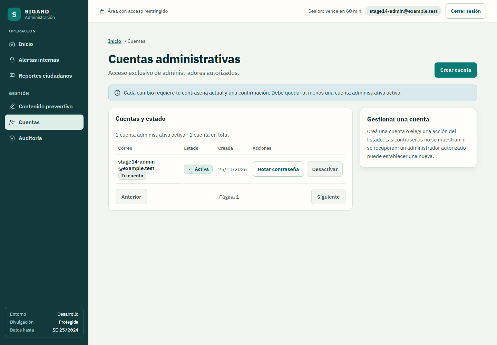

En **Reportes ciudadanos → Gestionar cuentas** podés:

- **Crear cuenta**: correo y contraseña inicial (8 a 200 caracteres). Entregá la contraseña por un
  medio seguro, nunca por chat ni correo.
- **Rotar contraseña**: establece una contraseña nueva para tu cuenta o para la de otra persona.
  Cierra todas las sesiones abiertas de esa cuenta.
- **Desactivar**: bloquea el ingreso y cierra las sesiones de la cuenta. Se usa cuando alguien
  deja el equipo. Las cuentas no se borran.

Cada acción pide **tu contraseña actual** y una confirmación. Siempre tiene que quedar **al menos
una cuenta activa**, por lo que el sistema no te deja desactivar la última. Cada cambio queda
auditado con quién lo hizo, sobre qué cuenta y cuándo. La auditoría nunca guarda contraseñas.

## 3. Reportes ciudadanos

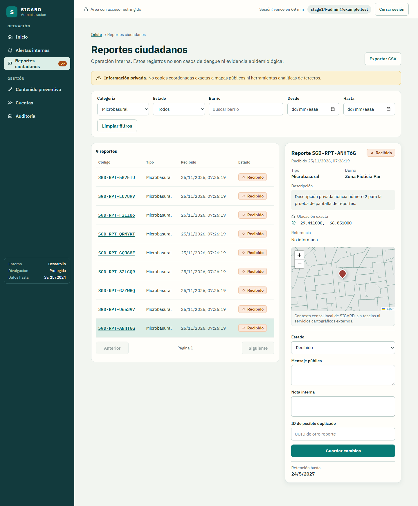

La bandeja muestra los reportes anónimos que envía la ciudadanía.

1. **Filtrá** por categoría, estado, barrio o rango de fechas. **Limpiar filtros** vuelve a la
   lista completa.
2. **Abrí un reporte** de la lista para ver su detalle: código, categoría, ubicación exacta en el
   mapa, referencia, descripción y fecha de eliminación prevista («Retención hasta»).
3. **Actualizalo**:
   - **Estado**: Recibido → En revisión → Pendiente de derivación → Derivado → Resuelto, o
     Descartado;
   - **Mensaje público** (hasta 600 caracteres): es lo único que ve el ciudadano al consultar
     su código, así que no incluyas datos personales ni direcciones;
   - **Nota interna** (hasta 2000 caracteres): sólo la ve el equipo;
   - **ID de posible duplicado**: el identificador de otro reporte sobre el mismo problema.
4. Tocá **Guardar cambios**.

**Exportar CSV** descarga los reportes **con los filtros aplicados**. El archivo neutraliza las
celdas que empiezan con `=`, `+`, `-` o `@`, para que no se ejecuten como fórmulas al abrirlo en
una planilla.

**Auditoría:** se registran la consulta del detalle, cada actualización y cada exportación, con el
usuario y la fecha.

> **Información privada.** La ubicación exacta de un reporte no se copia a mapas públicos, a
> planillas compartidas ni a herramientas de terceros. Los reportes se eliminan solos al vencer
> su plazo de retención (180 días por defecto).

## 4. Contenido preventivo

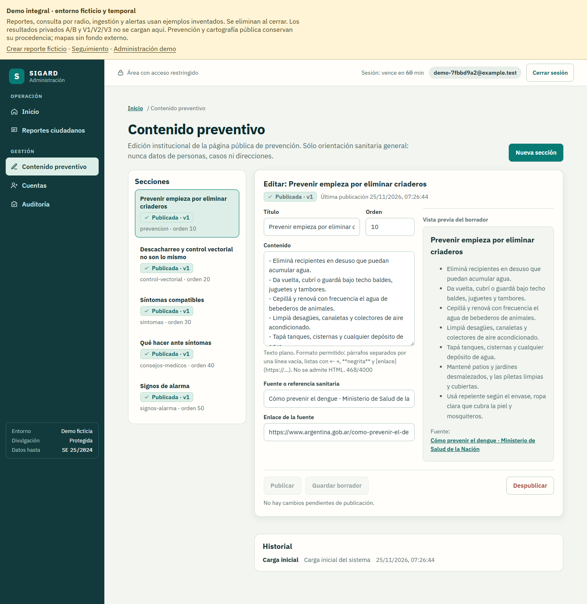

En **Reportes ciudadanos → Contenido preventivo** se editan las secciones de la página pública
**Prevención y ayuda**: prevención, control vectorial, síntomas, consejos médicos y signos de
alarma.

**Ciclo de una sección:**

| Paso | Qué pasa |
|---|---|
| Editar | Cambiás la **copia de trabajo** (borrador). Lo público no cambia todavía |
| Publicar | Se congela una nueva **versión** y pasa a ser lo que ve la ciudadanía. Exige fuente y enlace sanitario `https://` |
| Despublicar | La sección deja de mostrarse. El texto y el historial se conservan |

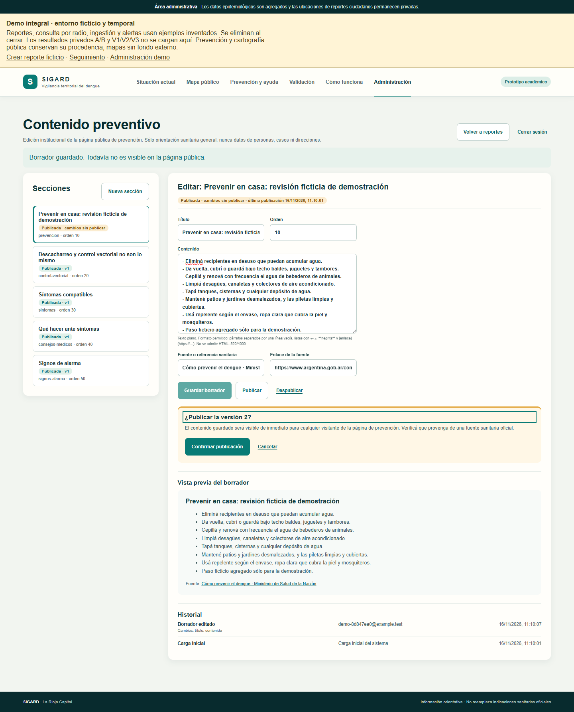

**Formato permitido:** texto, párrafos, listas que empiezan con `- `, `**negrita**` y enlaces
`[texto](https://…)`. El sistema **rechaza** HTML, enlaces que no sean `https://`, correos y
números con formato de documento. Esto es un resguardo y no garantiza que no haya datos
personales: el contenido tiene que ser información sanitaria general.

**Conflictos:** si otra persona guardó la misma sección mientras la editabas, el sistema avisa y
no pisa sus cambios. Recargá la sección y volvé a aplicar tu edición.

**Historial:** cada sección muestra quién creó, editó, publicó o despublicó, y cuándo.

Los teléfonos, los centros de salud y las fuentes generales no se editan acá: provienen de los
archivos públicos revisados del sitio.

## 5. Visor predictivo

El visor se abre en **Módulo predictivo** (`/mapa`) sólo en el entorno local de investigación
(`npm run dev`). Es una **reconstrucción histórica 2021–2024**: muestra qué hubiera estimado cada
método para la semana siguiente y lo compara con lo que ocurrió. **No es un pronóstico actual ni
un sistema operativo.**

### 5.1 Elegir la semana

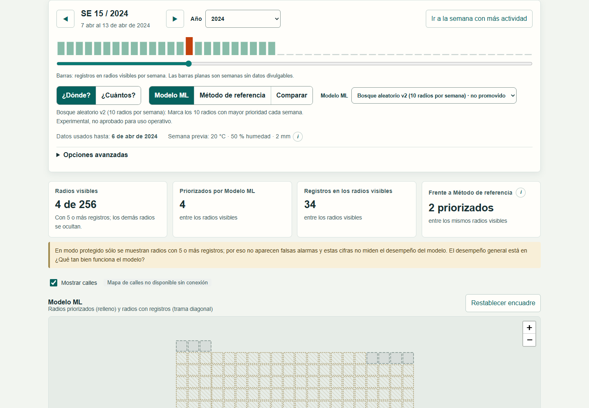

- Usá las flechas ◀ ▶, el selector **Año** o la línea de tiempo. Cada barra es una semana, y las
  barras planas son semanas sin datos divulgables.
- **Ir a la semana con más actividad** salta a la semana más informativa del año.
- **Datos usados hasta** indica hasta qué fecha llegaba la información disponible para estimar.
  La línea de clima resume la semana previa (contexto de la ciudad, un único punto de
  referencia).

### 5.2 Las dos preguntas

| Pregunta | Qué responde | Cómo se ve |
|---|---|---|
| **¿Dónde?** | Qué radios convenía priorizar esa semana | Radios **priorizados** en relleno y radios **con registros** con trama diagonal |
| **¿Cuántos?** | Cuántos registros se esperaban por radio | Colores por cantidad. Con **Esperados / Observados** alternás entre lo estimado y lo ocurrido |

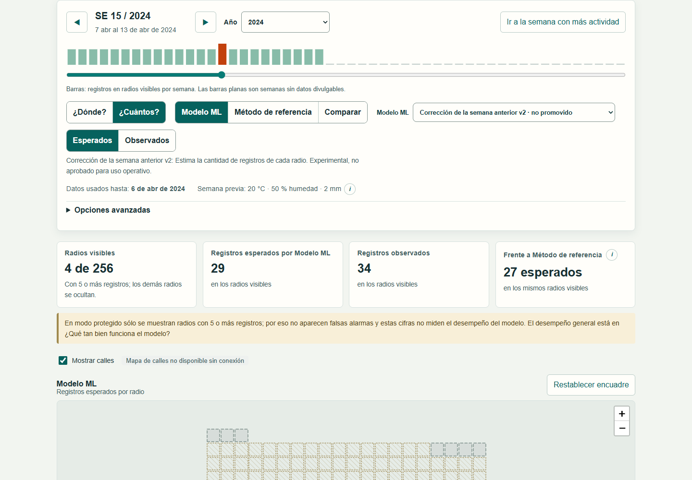

**Regla top-10 (¿Dónde?).** El modelo ML de presencia (*Bosque aleatorio v2*) marca cada semana
los **10 radios con mayor prioridad**. No es una probabilidad de riesgo sanitario. En el panel
de un radio se ve «Priorizado (puesto N)».

### 5.3 Modelo ML, método de referencia y comparación

- **Modelo ML**: los candidatos experimentales. Por defecto son *Bosque aleatorio v2* en
  ¿Dónde? y *Corrección de la semana anterior v2* en ¿Cuántos?. Todos están rotulados **«no
  promovido»**: se evaluaron, pero no están aprobados para uso operativo.
- **Método de referencia**: una regla estadística simple. Repite lo ocurrido la semana anterior
  (persistencia) o se basa en la estacionalidad.
- **Comparar**: muestra los dos mapas lado a lado con el mismo encuadre.

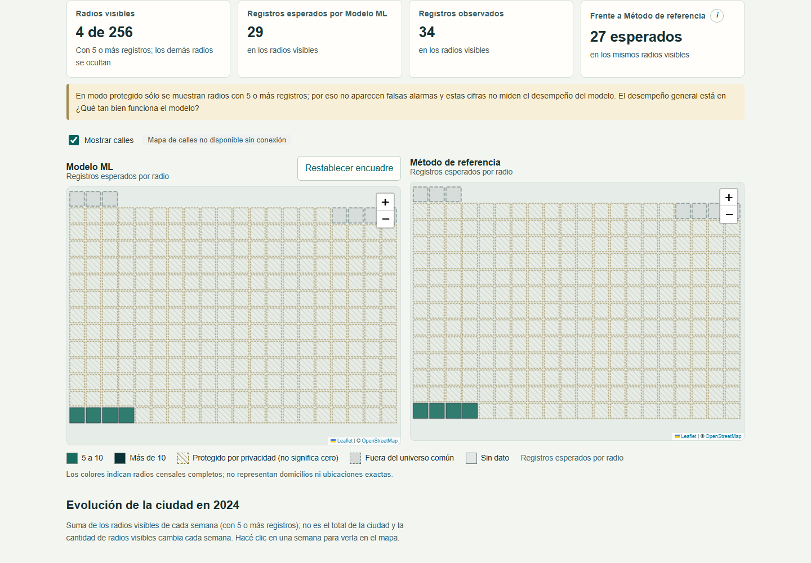

Las tarjetas resumen los radios visibles, lo esperado por cada método y lo observado. La sección
**¿Qué tan bien funciona el modelo?** muestra el desempeño general por año. Ese desempeño es la
única medida válida de calidad, porque las cifras de una semana en modo protegido no lo miden.

**Resultado de la evaluación** (desarrollo 2021–2023):

- En ¿Cuántos?, *Corrección de la semana anterior v2* tuvo un **error 13,6 % menor** que la
  persistencia, una diferencia estadísticamente sostenida.
- En ¿Dónde?, *Bosque aleatorio v2* **empató** con la persistencia.
- Ninguno se promovió, porque no cumplieron todos los criterios fijados de antemano.

### 5.4 Panel de un radio

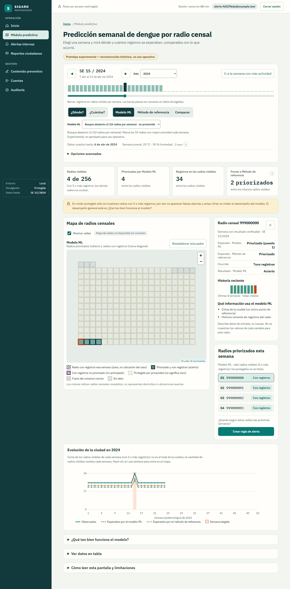

Tocá un radio en el mapa o elegilo en el selector para ver:

- qué esperaba cada método;
- qué ocurrió y si fue acierto;
- la **historia reciente** de las últimas 8 semanas;
- **qué información usa el modelo** (sin mostrar los valores de cada variable).

**Restablecer encuadre** vuelve al mapa completo.

### 5.5 Modo protegido

El visor trabaja siempre en **modo protegido**. En **Opciones avanzadas** se lee «Modo de
divulgación: protegido».

- Sólo se muestran los radios con **5 o más registros**. Los demás aparecen como «Protegido por
  privacidad (no significa cero)».
- Por eso, en modo protegido no aparecen las falsas alarmas, y las cifras de una semana **no
  miden el desempeño** del modelo.
- Los colores representan **radios censales completos**, no domicilios ni ubicaciones de casos.

## 6. Alertas internas

Se abren en **Reportes ciudadanos → Alertas internas**, en el entorno `npm run dev`. Son
**avisos internos para el equipo, con aprobación humana**. Ningún algoritmo publica alertas y no
se envían correos, SMS ni avisos a la ciudadanía.

### 6.1 Reglas

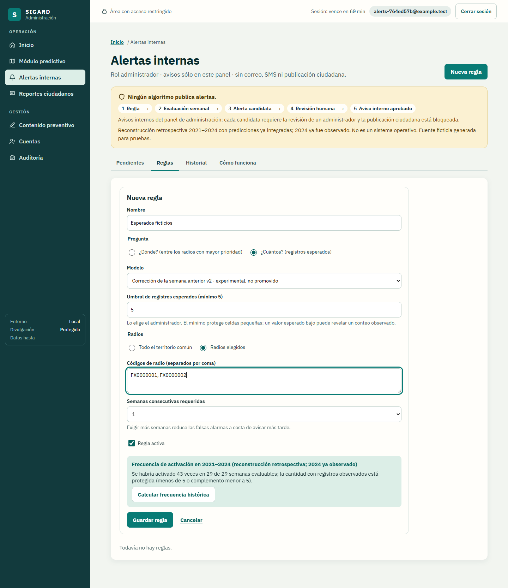

En la pestaña **Reglas**, creá una regla eligiendo:

| Campo | Opciones |
|---|---|
| Radios | Todo el territorio común (256) o un conjunto elegido |
| Pregunta | **¿Dónde?**: el radio entra en el top-10 del modelo. **¿Cuántos?**: se esperan al menos *N* registros, con **N ≥ 5** |
| Modelo | El candidato v2, v1 o la referencia, según la pregunta |
| Semanas consecutivas | De 1 a 4. La condición debe cumplirse en todas, lo que reduce las falsas alarmas |
| Activa / inactiva | Una regla inactiva nunca dispara. Las reglas no se borran: se desactivan |

**Antes de guardar** la pantalla calcula la **frecuencia de activación en 2021–2024**, es decir,
cuántas veces se hubiera disparado la regla en la reconstrucción histórica (2024 ya fue
observado). Sin ese cálculo no se puede guardar, y sirve para elegir un umbral razonable. Cada
edición crea una nueva versión de la regla.

### 6.2 Evaluar una semana

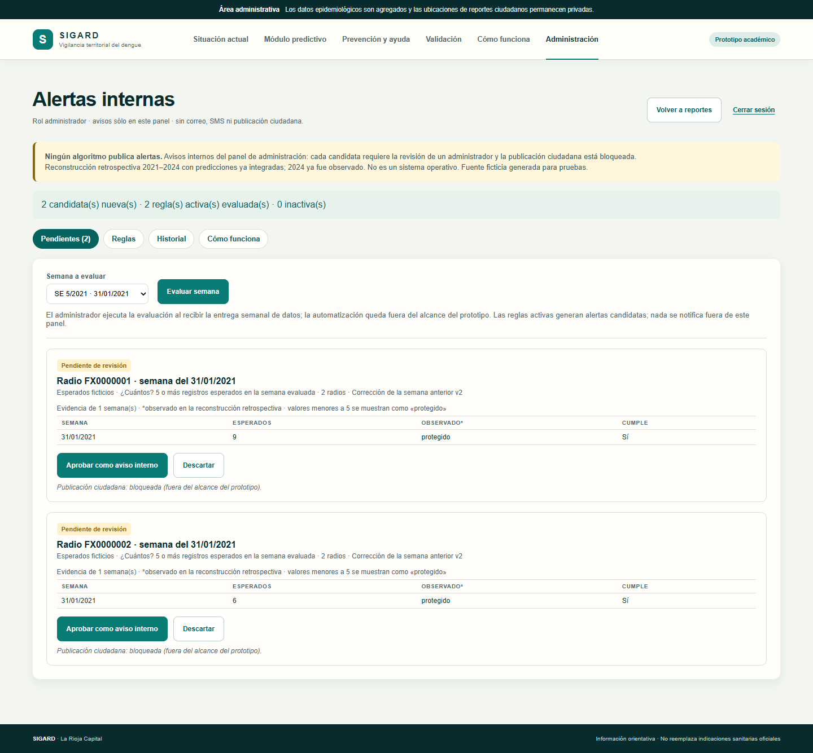

1. En **Pendientes**, elegí la **semana a evaluar** y tocá **Evaluar semana**. Se hace a mano,
   cuando llega la entrega semanal de datos.
2. Cada regla activa que se cumple genera **alertas candidatas**, con la evidencia de las semanas
   de la ventana. Los valores menores a 5 se muestran como «protegido».
3. Revisá cada candidata:
   - **Aprobar como aviso interno**, con un comentario obligatorio;
   - **Descartar**, con un motivo (falsa alarma, contexto insuficiente, duplicada u otro) y un
     detalle.
4. Volver a evaluar la misma semana no duplica candidatas.

### 6.3 Historial

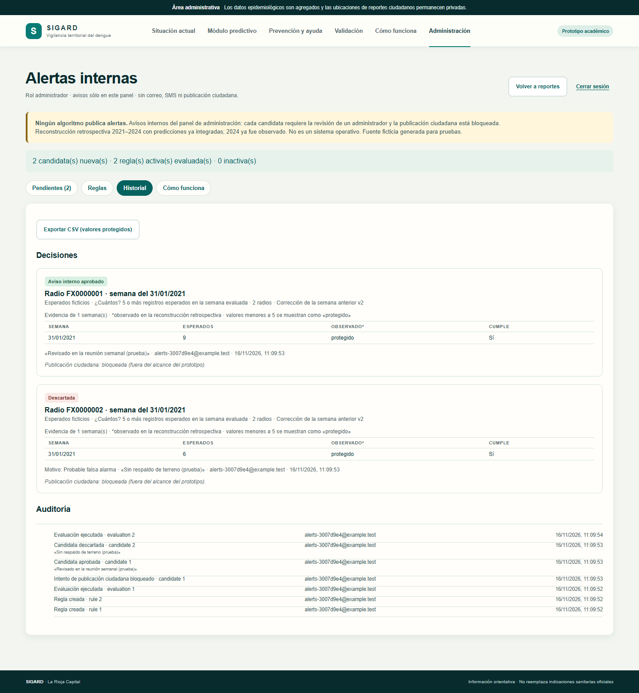

La pestaña **Historial** registra reglas, evaluaciones, aprobaciones y descartes, con su autor y
su fecha. La pestaña **Cómo funciona** resume el circuito para quien lo usa por primera vez.

### 6.4 Por qué no se publican

- Los modelos son **experimentales y no promovidos**, y la reconstrucción es retrospectiva.
- Una alerta pública mal calibrada puede generar alarma o señalar barrios.
- La publicación ciudadana está **bloqueada en el código y en la base de datos**: no existe el
  estado «publicada», y el intento de publicar se rechaza y queda auditado.

## 7. Buenas prácticas de privacidad

1. **Nunca copies** ubicaciones exactas, descripciones ni exportaciones a mapas públicos, redes,
   chats o servicios de terceros.
2. Guardá las exportaciones CSV sólo en equipos institucionales y borralas cuando ya no sirvan.
3. En los mensajes públicos y en el contenido preventivo **no incluyas datos personales**:
   nombres, documentos, teléfonos particulares ni direcciones de domicilios.
4. No compartas tu cuenta. Cada persona tiene la suya, y la auditoría registra quién hizo cada
   cosa.
5. Cerrá la sesión al terminar, sobre todo en equipos compartidos.
6. Cuando alguien deja el equipo, **desactivá su cuenta**.
7. En presentaciones usá el visor en **modo protegido** y datos ficticios. Los valores menores
   a 5 nunca se muestran ni se comentan.
8. No publiques capturas del panel con reportes reales.
