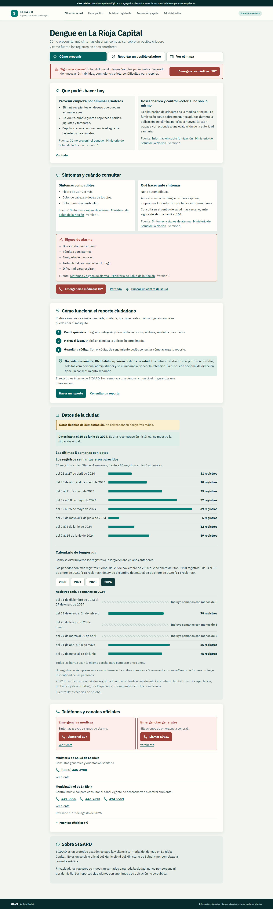
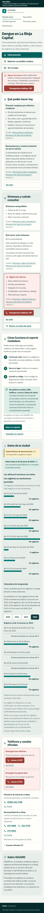
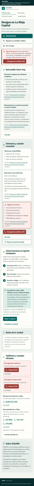
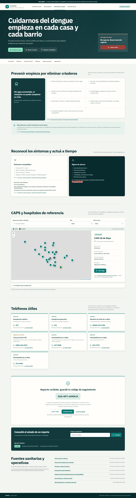
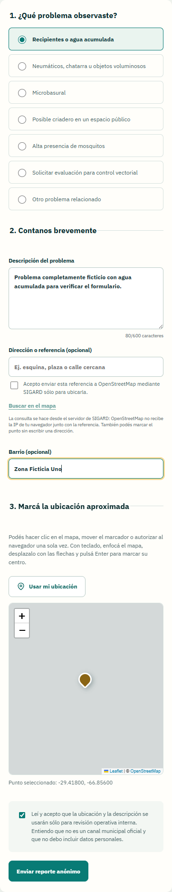
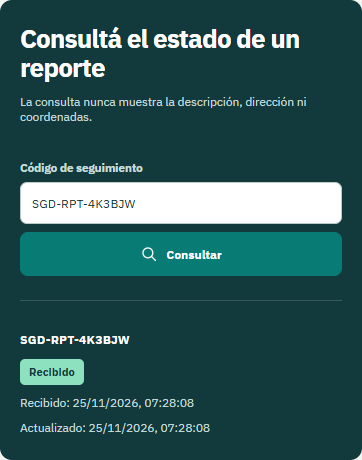
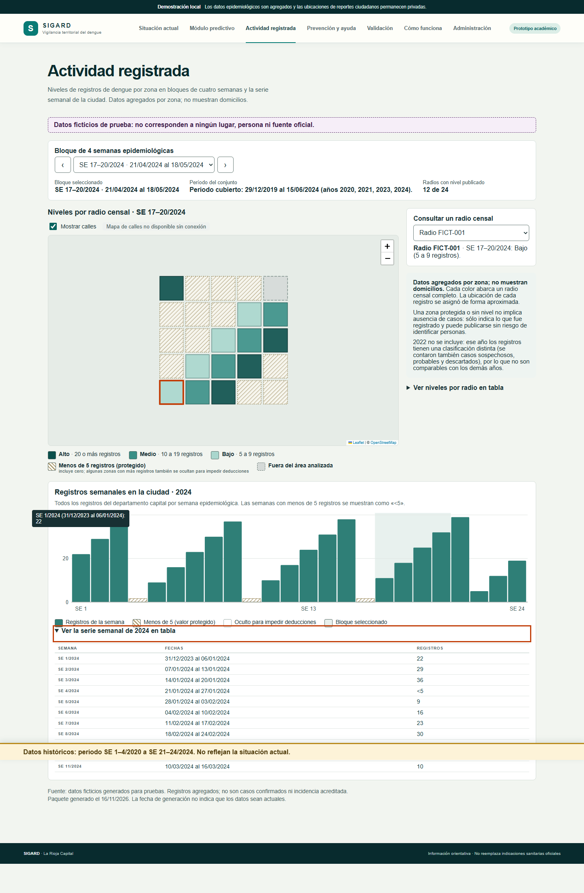
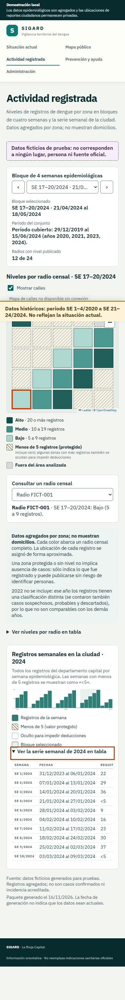

# Manual de uso para la ciudadanía

SIGARD · Vigilancia territorial del dengue · La Rioja Capital
Versión del prototipo: `v1.0.0` (noviembre de 2026)

> Las imágenes de este manual se tomaron con **datos ficticios de prueba**. No muestran casos
> reales ni la situación sanitaria de la ciudad. Se actualizaron el 27/11/2026 con las pantallas
> vigentes.

## 1. ¿Qué es SIGARD?

SIGARD es un **prototipo académico** de la Universidad Nacional de La Rioja para la vigilancia
territorial del dengue en la Capital. Desde el sitio público podés:

- ver **información de prevención**: qué hacer en casa, síntomas, signos de alarma, centros de
  salud y teléfonos útiles;
- enviar un **reporte anónimo** sobre un posible criadero o un problema relacionado con el
  mosquito, y consultar después su estado;
- cuando el Ministerio de Salud lo autorice, ver la **actividad registrada** de dengue en años
  anteriores, agrupada por zonas.

**SIGARD no es un canal de emergencias ni da diagnósticos.** Ante fiebre o signos de alarma,
consultá en un centro de salud. Ante una emergencia, llamá al **107**.

## 2. Cómo moverse por el sitio

En la parte superior hay un menú con estas secciones:

| Sección | Para qué sirve |
|---|---|
| Situación actual | Portada: accesos rápidos, signos de alarma, prevención, síntomas, reporte, datos de la ciudad y canales oficiales |
| Mapa público | Mapa de contexto de la ciudad |
| Actividad registrada | Datos históricos protegidos por zona (sólo aparece si está habilitada) |
| Prevención y ayuda | Prevención, síntomas, centros de salud, teléfonos, reporte y seguimiento |
| Administración | Uso exclusivo del personal autorizado |

El sitio funciona en computadora y en celular, y se puede recorrer con el teclado (tecla Tab).

## 3. Situación actual (portada)

La portada reúne lo más útil en una sola página, en este orden:

1. **Título y tres accesos**: **Cómo prevenir**, **Reportar un posible criadero** y **Ver el mapa**.
2. **Franja de signos de alarma**: justo debajo de los accesos, visible sin desplazarse en el
   celular. Muestra los signos de alarma publicados por el equipo de salud y un botón para llamar
   al número de emergencia, sólo si ese teléfono está confirmado; si no lo está, un enlace a
   Síntomas.
3. **Qué podés hacer hoy**: los 3 primeros puntos de cada tema de prevención y el enlace **Ver
   todo**, que lleva a la guía completa en Prevención y ayuda.
4. **Síntomas y cuándo consultar**: los 3 primeros puntos de cada tema y **Ver todo**. Los **signos
   de alarma** se muestran siempre completos, en un recuadro rojo claro.
5. **Cómo funciona el reporte ciudadano**: los pasos y qué datos se guardan.
6. **Datos de la ciudad**: los registros de las últimas 8 semanas con datos y el calendario de
   temporada, juntos, con la fecha del último dato. **Es una reconstrucción histórica: no muestra
   la situación actual.** Las semanas con menos de 5 registros aparecen como «Menos de 5»; si
   alguna semana está protegida, el sitio no calcula si los registros subieron o bajaron. En el
   calendario elegí el año con los botones; todas las barras usan la misma escala y los períodos
   con alguna semana protegida se ven con rayas y sin total.
7. **Teléfonos y canales oficiales**: las líneas de emergencia con botón para llamar, y el
   Ministerio y la Municipalidad en una lista breve (las líneas municipales juntas), con la fecha
   de revisión. Las **Fuentes oficiales** se despliegan al tocar su título.
8. **Sobre SIGARD**: qué es y cómo se cuida la privacidad.

Mientras el Ministerio de Salud no autorice publicar los registros, **Datos de la ciudad** muestra
un único aviso en lugar de cifras. Cuando la página usa datos de prueba, lo indica con el aviso
**«Datos ficticios de demostración»**.

## 4. Prevención y ayuda

En **Prevención y ayuda** vas a encontrar:

1. **Prevenir empieza por eliminar criaderos**: acciones simples para tu casa y tu barrio, como
   vaciar recipientes, tapar tanques y limpiar desagües.
2. **Síntomas y signos de alarma**: qué observar y cuándo consultar sin esperar.
3. **CAPS y hospitales de referencia**: un mapa con 24 centros de atención primaria y los
   hospitales. Podés buscar por nombre o domicilio y filtrar por tipo o barrio. Cada centro
   muestra su horario publicado y un botón **Cómo llegar**. Los horarios pueden cambiar:
   confirmalos antes de ir.
4. **Teléfonos útiles**: emergencias, Ministerio de Salud y Municipalidad, con la fecha en que se
   revisó cada número.
5. **Fuentes**: cada texto indica de dónde sale (Ministerio de Salud de la Nación o de La Rioja).

El contenido lo actualiza el personal autorizado. Si el servicio no está disponible, el sitio
muestra igual una versión guardada de la información.

## 5. Enviar un reporte anónimo

Usalo para avisar sobre **posibles criaderos o problemas en el espacio público**: agua acumulada,
neumáticos o chatarra, microbasurales, mucha presencia de mosquitos o un pedido de control
vectorial. **No lo uses para informar casos de enfermedad ni datos de personas.**

Pasos:

1. En **Prevención y ayuda**, tocá **Reportar un problema**.
2. Elegí la **categoría** que mejor describe el problema.
3. Escribí una **descripción** de entre 20 y 600 caracteres. Contá qué viste y dónde, **sin
   nombres, teléfonos ni datos personales**.
4. Indicá la **ubicación** de una de estas formas:
   - tocá el punto en el mapa (podés arrastrar el marcador para corregirlo);
   - usá **Usar mi ubicación** (el navegador te pide permiso);
   - escribí una dirección o referencia y aceptá buscarla en el mapa.

   El punto tiene que estar dentro del área marcada de la ciudad.
5. Si querés, agregá una referencia (por ejemplo, «frente a la plaza») y el barrio.
6. Leé y aceptá el aviso de privacidad, y enviá.

Al terminar, el sitio te muestra un **código de seguimiento** con el formato `SGD-RPT-XXXXXX`.
**Guardalo**: es la única forma de consultar tu reporte, porque el sistema no te pide nombre ni
correo.

## 6. Consultar el estado de un reporte

En **Consultá el estado de un reporte**, escribí tu código y tocá **Consultar**. Vas a ver:

| Estado | Qué significa |
|---|---|
| Recibido | El reporte llegó y espera revisión |
| En revisión | Una persona del equipo lo está mirando |
| Pendiente de derivación | Se va a enviar al área que corresponda |
| Derivado | Se envió al área que corresponda |
| Resuelto | Se completó la gestión |
| Descartado | No correspondía o no se pudo verificar |

También se muestran las fechas de recepción y de última actualización y, a veces, un mensaje
breve del equipo. **La consulta nunca muestra la descripción, la dirección ni las coordenadas**
del reporte.

## 7. Actividad registrada (datos históricos)

Esta sección muestra **cuánta actividad de dengue se registró en años anteriores**, por radio
censal. Un radio censal es una zona pequeña de la ciudad que usa el censo. Sólo aparece en el
menú cuando el Ministerio de Salud autoriza publicar los datos. Mientras tanto, la sección no
está disponible.

**Cómo leerla:**

- **Son datos históricos.** Un aviso fijo en la parte inferior indica el período, por ejemplo
  «Datos históricos: período SE 1–4/2020 a SE 21–24/2024. No reflejan la situación actual.».
  SE significa «semana epidemiológica».
- Los datos se agrupan en **bloques de 4 semanas**. Elegí el bloque con el selector y mirá su
  rango de fechas.
- Cada zona tiene un **nivel**:

  | Nivel | Registros en el bloque |
  |---|---|
  | Alto | 20 o más |
  | Medio | 10 a 19 |
  | Bajo | 5 a 9 |
  | Menos de 5 registros (protegido) | De 0 a 4, que incluye cero, y algunas zonas que se ocultan para proteger a otras |

- Las zonas **protegidas** se dibujan con rayas diagonales. Que una zona esté protegida **no
  significa que no haya habido casos**, y tampoco que haya habido pocos.
- Abajo hay una **serie semanal de la ciudad**. Las semanas con menos de 5 registros aparecen
  como «<5».
- **El año 2022 no se incluye**, porque ese año los registros se clasificaron de otra manera y no
  son comparables con los demás.
- La «fecha de generación» indica cuándo se armó el paquete, **no** que los datos sean actuales.
- Si preferís leer en tablas, elegí un radio en el selector: los mismos datos aparecen como texto.

**Por qué se protegen los números chicos:** cuando una zona tiene pocos casos, publicar el número
exacto podría ayudar a identificar a una persona. Por eso los valores menores a 5 nunca se
muestran, y se ocultan también otros valores con los que se podría deducir un número protegido.

## 8. Privacidad

- Los reportes son **anónimos**: no se piden nombre, documento, correo ni teléfono.
- La ubicación exacta y la descripción de tu reporte sólo las ve el personal autorizado, dentro
  del panel administrativo. Nunca se publican en mapas.
- Los reportes se conservan un tiempo limitado (180 días por defecto) y después se eliminan.
- Los mapas públicos muestran **sólo datos agregados por zona**, nunca casos individuales.

## 9. Limitaciones

- SIGARD es un **prototipo académico en evaluación**, no un servicio oficial del Municipio ni del
  Ministerio. Enviar un reporte no garantiza una intervención.
- La información de prevención es orientativa y **no reemplaza la consulta médica** ni las
  indicaciones sanitarias oficiales.
- Los datos de «Actividad registrada» son históricos y aproximados: un registro no equivale
  necesariamente a un caso confirmado.
- Horarios y teléfonos pueden cambiar; cada uno indica la fecha en que se revisó.

## 10. Preguntas frecuentes

**Perdí mi código de seguimiento. ¿Puedo recuperarlo?**
No. Como el reporte es anónimo, no hay forma de asociarlo a vos. Podés enviar un reporte nuevo.

**¿Puedo reportar que tengo dengue?**
No. SIGARD no recibe datos de salud de personas. Consultá en tu centro de salud.

**La sección «Actividad registrada» no aparece. ¿Es un error?**
No. Sólo aparece cuando la publicación está autorizada y el servicio responde.

**Una zona aparece protegida. ¿Quiere decir que ahí no hubo dengue?**
No. Puede haber tenido de 0 a 4 registros, o haberse ocultado para proteger a otra zona.
