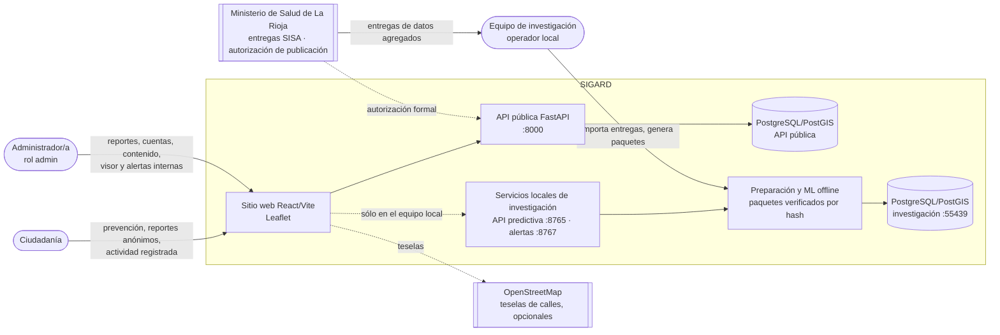
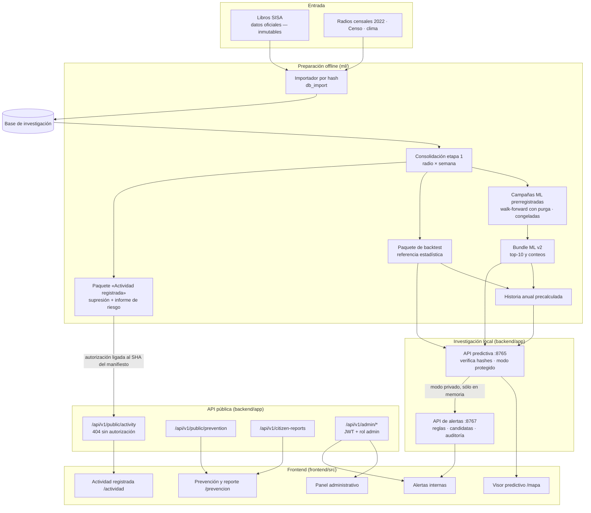

# Arquitectura de SIGARD

Estado de la rama `entrenamiento-ML` · `v0.9.1-aceptacion` (noviembre de 2026). Este documento
reemplaza como referencia vigente a `docs/architecture.md`, que describe la versión `v0.1` y se
conserva como registro histórico.

## 1. Principios

1. **Separación estricta** entre preparación/ML offline (`ml/`), persistencia y API
   (`backend/`), visualización (`frontend/`) y contratos (`docs/`).
2. **Nada se entrena ni se infiere al navegar.** Los modelos se ajustaron en campañas offline
   prerregistradas. La aplicación sólo lee **paquetes congelados** y verificados por SHA-256.
3. **Privacidad por diseño.** No hay casos individuales en ninguna vista. Los valores menores a
   5 se protegen siempre, los reportes ciudadanos son anónimos y la ubicación exacta sólo se ve
   en el panel autenticado.
4. **Falla cerrada.** Un archivo alterado, una autorización ausente o una entrada desactualizada
   bloquean la respuesta (404/503). Nunca se sirve un valor sin verificar.
5. **Dos bases independientes.** La API pública y la base de investigación no comparten tablas
   ni credenciales (ver [modelo de datos](modelo-datos.md)).

## 2. Diagrama de contexto

| Elemento | Despliegue previsto | Estado en el prototipo |
|---|---|---|
| Sitio web | Vercel (sólo el frontend estático) | Local con Vite (`dev`, `dev:demo`; `dev:alerts` es alias de `dev`) y build de producción probado con `vite preview` |
| API pública | Servidor institucional con PostgreSQL/PostGIS | Probada en SQLite y con la cadena de migraciones en PostGIS real (11/11) |
| API predictiva de investigación | **Sólo loopback local** (127.0.0.1:8765) | No se despliega. El bundle público no la contiene |
| API de alertas internas | Local (127.0.0.1:8767) con SQLite privado | Prototipo. En un despliegue sería parte de la API administrativa |
| Base de investigación | Clúster propio en WSL, puerto 55439 | Encendida sólo para importar o generar paquetes |

## 3. Diagrama lógico (flujo de datos)

## 4. Componentes

### 4.1 Frontend (`frontend/`)

- SPA React 19 + Vite 8 + Leaflet. Rutas públicas: `/`, `/mapa`, `/actividad`, `/prevencion`,
  `/validacion` y `/metodologia`. Ruta administrativa: `/admin/reportes`.
- El **visor predictivo** existe sólo con `import.meta.env.DEV` y origen `127.0.0.1:5173`. El
  bundle público muestra el mapa de contexto en su lugar.
- Las lecturas iniciales se reintentan **una vez** ante falla de red o 5xx
  (`services/readRetry.mjs`). Las escrituras nunca se reintentan.
- `frontend/public` sólo contiene recursos públicos aprobados por hash
  (`security/public-assets.json`).

### 4.2 API pública (`backend/app/main.py`)

- FastAPI + SQLAlchemy + Alembic. Prefijo `/api/v1`.
- Público: reportes anónimos y su estado, geocodificación, prevención publicada y actividad
  registrada (404 salvo autorización).
- Administrativo: 27 rutas, todas con `get_current_admin` (JWT HS256 con `token_version`).
- Auditoría transaccional de reportes, cuentas, contenido y alertas. Retención de reportes
  fuera del proceso web (`app/retention.py`).

### 4.3 Servicios locales de investigación

- `app.research_local` (127.0.0.1:8765, sin autenticación pero restringido a loopback y origen
  local): `/api/v1/research/predictive/*`.
  - Lee el paquete de backtest, los candidatos ML v1/v2 y la historia anual precalculada.
  - Verifica cada archivo con SHA-256 y una caché por proceso.
  - Aplica la protección de celdas menores a 5.
- `app.alerts_local` (127.0.0.1:8767, iniciada por `npm run dev`): API administrativa completa
  (login, reportes, contenido, cuentas y alertas) con SQLite privado. Lee la
  API predictiva en modo privado, sólo en memoria, y guarda únicamente valores ya protegidos.

### 4.4 Preparación y ML (`ml/src/sigard_ml/`)

- `ingestion/`: importación por hash, territorio, clima y analítica.
- `forecasting/`: consolidación, protocolos y campañas (v1, v2), bundles (backtest, ML v1/v2).
- `publication/activity_package.py`: paquete público con supresión primaria y complementaria.
- Todo escribe en carpetas nuevas de `data/interim/official` o `data/processed/official`
  (ignoradas por Git), sin sobrescribir.

## 5. Seguridad y privacidad (resumen)

| Medida | Dónde |
|---|---|
| Mínimo 5 en toda salida derivada de datos epidemiológicos | `predictive_service.protect_week`, `alert_rules`, `activity_package` |
| Supresión complementaria (atacante del peor caso) | `activity_package.disclosure` |
| Publicación real sólo con autorización ligada al SHA del manifiesto | `public_activity.load_authorized_package` |
| Paquetes verificados por SHA-256 en cada lectura | `experimental_results.local_bytes` |
| Historia precalculada ligada a sus entradas y al código | `predictive_history.bindings` |
| RBAC y revocación de sesiones | `security.py` (`get_current_admin`), `admin_accounts.py` |
| Publicación ciudadana de alertas imposible | Ruta 409 auditada + `CHECK` de estado |
| Auditoría estática del repositorio | `tools/check_repository_security.py` |

Las decisiones de diseño están justificadas en el [registro de decisiones](decisiones.md).
