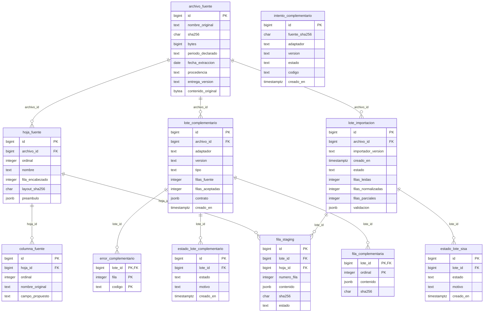
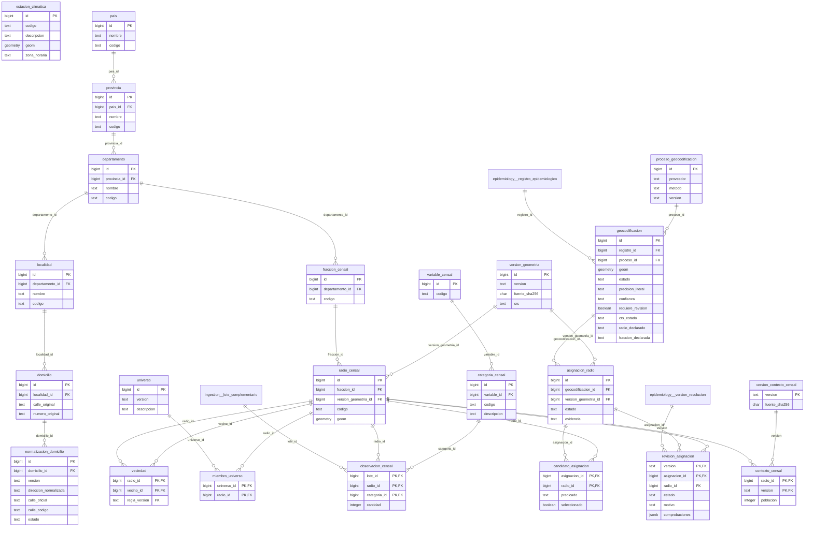

# Modelo de datos (entidad-relación)

> **Archivo generado** por `tools/generate_erd.py` a partir de las migraciones. No editar a mano:
> volver a generarlo con `.\backend\.venv\Scripts\python.exe -B tools/generate_erd.py`. `--check`
> falla si quedó desactualizado.

SIGARD usa **dos bases separadas**:

| Base | Uso | Migraciones | Origen de este modelo |
|---|---|---|---|
| API pública (PostgreSQL/PostGIS; SQLite en demos y pruebas) | Reportes ciudadanos, cuentas, contenido preventivo, alertas internas, publicación | `backend/migrations` (Alembic, 20260819_01…20261114_06) | SQL de `alembic upgrade head --sql` (sin conexión) |
| Investigación (PostgreSQL 16/PostGIS 3, clúster local 55439) | Ingesta SISA, territorio, analítica, consolidación y registro del motor | `backend/epidemiology_migrations` (epi01…epi15) | SQL que aplican esas migraciones, en orden de revisión |

Las dos bases no comparten tablas ni conexiones. Los modelos y la API de investigación leen paquetes
offline verificados por hash, no estas tablas en línea. Las vistas no se incluyen en los diagramas.

## 1. Base de la API pública (15 tablas)

```mermaid
erDiagram
    admin_account_audit {
        serial id PK
        integer actor_user_id FK
        integer target_user_id FK
        varchar action
        timestamp created_at
    }
    citizen_report_audit {
        serial id PK
        varchar report_id FK
        integer actor_user_id FK
        varchar action
        text changes_json
        timestamp created_at
    }
    citizen_reports {
        varchar id PK
        varchar tracking_code
        varchar submission_key_hash
        varchar category
        text description
        float latitude
        float longitude
        geometry geom
        varchar address_reference
        varchar neighborhood
        varchar status
        text public_status_message
        text internal_notes
        varchar possible_duplicate_of FK
        varchar privacy_notice_version
        timestamp created_at
        timestamp updated_at
        timestamp retention_until
    }
    experimental_spatial_results {
        varchar batch_id PK, FK
        date cutoff_date PK, FK
        varchar radio_id PK, FK
        date target_week_start
        date target_week_end
        float experimental_spatial_score
        float percentile
        varchar relative_level
        varchar synthetic_scenario
    }
    internal_alert_audit {
        serial id PK
        integer actor_user_id FK
        varchar action
        varchar entity
        integer entity_id
        json before_json
        json after_json
        timestamp created_at
    }
    internal_alert_candidates {
        serial id PK
        integer rule_id FK
        integer rule_revision
        json rule_json
        integer evaluation_id FK
        date target_week
        varchar radio_id
        json evidence_json
        varchar status
        text decision_comment
        varchar discard_reason
        integer decided_by_user_id FK
        timestamp decided_at
        timestamp created_at
        integer revision
    }
    internal_alert_evaluations {
        serial id PK
        date target_week
        varchar status
        json source_json
        json summary_json
        integer triggered_by_user_id FK
        timestamp created_at
    }
    internal_alert_rules {
        serial id PK
        varchar name
        varchar capability
        varchar model
        json radio_ids
        float threshold
        integer consecutive_weeks
        boolean enabled
        integer revision
        integer created_by_user_id FK
        integer updated_by_user_id FK
        timestamp created_at
        timestamp updated_at
    }
    prevention_audit {
        serial id PK
        integer section_id FK
        integer actor_user_id FK
        varchar action
        json before_json
        json after_json
        timestamp created_at
    }
    prevention_sections {
        serial id PK
        varchar slug
        varchar title
        text body
        integer position
        varchar source_label
        varchar source_url
        varchar status
        integer revision
        integer version
        json published_json
        integer created_by_user_id FK
        integer updated_by_user_id FK
        integer published_by_user_id FK
        timestamp created_at
        timestamp updated_at
        timestamp published_at
    }
    publication_batches {
        varchar id PK
        varchar version
        varchar input_hash
        varchar status
        date default_cutoff_date
        json metadata_json
        json model_evaluation_json
        timestamp created_at
        timestamp published_at
    }
    publication_weeks {
        varchar batch_id PK, FK
        date cutoff_date PK
        date target_week_start
        date target_week_end
        varchar cutoff_label
        varchar target_week_label
        boolean has_temporal_prediction
        boolean has_experimental_spatial
    }
    temporal_predictions {
        varchar batch_id PK, FK
        date cutoff_date PK, FK
        date target_week_start
        date target_week_end
        float predicted_cases
        integer predicted_cases_rounded
        float official_cases
        float absolute_error
        float persistence_prediction
        float persistence_absolute_error
    }
    territorial_radios {
        varchar batch_id PK, FK
        varchar radio_id PK
        integer population
        float population_density
        integer households
        integer dwellings
        float area_km2
        float demographic_residential_component
        float density_component
        float territorial_context_score
        float percentile
        varchar relative_level
        geometry geom
    }
    usuarios {
        serial id PK
        varchar email
        varchar password_hash
        varchar rol
        boolean activo
        timestamp created_at
        integer token_version
    }
    usuarios ||--o{ admin_account_audit : "actor_user_id"
    usuarios ||--o{ admin_account_audit : "target_user_id"
    citizen_reports ||--o{ citizen_report_audit : "report_id"
    usuarios ||--o{ citizen_report_audit : "actor_user_id"
    citizen_reports ||--o{ citizen_reports : "possible_duplicate_of"
    publication_weeks ||--o{ experimental_spatial_results : "batch_id, cutoff_date"
    territorial_radios ||--o{ experimental_spatial_results : "batch_id, radio_id"
    usuarios ||--o{ internal_alert_audit : "actor_user_id"
    internal_alert_rules ||--o{ internal_alert_candidates : "rule_id"
    internal_alert_evaluations ||--o{ internal_alert_candidates : "evaluation_id"
    usuarios ||--o{ internal_alert_candidates : "decided_by_user_id"
    usuarios ||--o{ internal_alert_evaluations : "triggered_by_user_id"
    usuarios ||--o{ internal_alert_rules : "created_by_user_id"
    usuarios ||--o{ internal_alert_rules : "updated_by_user_id"
    prevention_sections ||--o{ prevention_audit : "section_id"
    usuarios ||--o{ prevention_audit : "actor_user_id"
    usuarios ||--o{ prevention_sections : "created_by_user_id"
    usuarios ||--o{ prevention_sections : "updated_by_user_id"
    usuarios ||--o{ prevention_sections : "published_by_user_id"
    publication_batches ||--o{ publication_weeks : "batch_id"
    publication_weeks ||--o{ temporal_predictions : "batch_id, cutoff_date"
    publication_batches ||--o{ territorial_radios : "batch_id"
```

| Tabla | Columnas | Clave primaria | Referencia a |
|---|---|---|---|
| `public.admin_account_audit` | 5 | id | `public.usuarios` |
| `public.citizen_report_audit` | 6 | id | `public.citizen_reports`, `public.usuarios` |
| `public.citizen_reports` | 18 | id | `public.citizen_reports` |
| `public.experimental_spatial_results` | 9 | batch_id, cutoff_date, radio_id | `public.publication_weeks`, `public.territorial_radios` |
| `public.internal_alert_audit` | 8 | id | `public.usuarios` |
| `public.internal_alert_candidates` | 15 | id | `public.internal_alert_evaluations`, `public.internal_alert_rules`, `public.usuarios` |
| `public.internal_alert_evaluations` | 7 | id | `public.usuarios` |
| `public.internal_alert_rules` | 13 | id | `public.usuarios` |
| `public.prevention_audit` | 7 | id | `public.prevention_sections`, `public.usuarios` |
| `public.prevention_sections` | 17 | id | `public.usuarios` |
| `public.publication_batches` | 9 | id | — |
| `public.publication_weeks` | 8 | batch_id, cutoff_date | `public.publication_batches` |
| `public.temporal_predictions` | 10 | batch_id, cutoff_date | `public.publication_weeks` |
| `public.territorial_radios` | 13 | batch_id, radio_id | `public.publication_batches` |
| `public.usuarios` | 7 | id | — |

## 2. Base de investigación (91 tablas en 4 esquemas)

Un diagrama por esquema. Las entidades de otro esquema aparecen como `esquema__tabla`.

### 2.1 Esquema `ingestion` (11 tablas)

| Tabla | Columnas | Clave primaria | Referencia a |
|---|---|---|---|
| `ingestion.archivo_fuente` | 9 | id | — |
| `ingestion.columna_fuente` | 5 | id | `ingestion.hoja_fuente` |
| `ingestion.error_complementario` | 3 | codigo, fila, lote_id | `ingestion.lote_complementario` |
| `ingestion.estado_lote_complementario` | 5 | id | `ingestion.lote_complementario` |
| `ingestion.estado_lote_sisa` | 5 | id | `ingestion.lote_importacion` |
| `ingestion.fila_complementaria` | 4 | lote_id, ordinal | `ingestion.lote_complementario` |
| `ingestion.fila_staging` | 7 | id | `ingestion.hoja_fuente`, `ingestion.lote_importacion` |
| `ingestion.hoja_fuente` | 7 | id | `ingestion.archivo_fuente` |
| `ingestion.intento_complementario` | 7 | id | — |
| `ingestion.lote_complementario` | 9 | id | `ingestion.archivo_fuente` |
| `ingestion.lote_importacion` | 9 | id | `ingestion.archivo_fuente` |

### 2.2 Esquema `epidemiology` (24 tablas)

```mermaid
erDiagram
    agregado_publico {
        bigint lote_id PK, FK
        bigint departamento_id PK, FK
        bigint semana_id PK, FK
        bigint evento_id PK, FK
        bigint grupo_etario_id PK, FK
        integer cantidad
    }
    catalogo_clasificacion {
        bigint id PK
        text codigo
    }
    clase_admitida {
        bigint politica_id PK, FK
        bigint catalogo_id PK, FK
    }
    clasificacion_registro {
        bigint id PK
        bigint registro_id FK
        bigint columna_id FK
        text valor_literal
        date fecha_revision
    }
    clima_diario {
        bigint lote_id PK, FK
        bigint estacion_id PK, FK
        date fecha PK
        float temperatura_min
        float temperatura_max
        float temperatura_media
        float humedad_media
        float precipitacion
        timestamptz disponible_desde
    }
    cobertura_fuente {
        bigint id PK
        bigint archivo_id FK
        bigint universo_id FK
        bigint criterio_id FK
        date inicio
        date fin
    }
    criterio_cobertura {
        bigint id PK
        text version
        bigint politica_clasificacion_id FK
        text definicion_poblacion
        text filtro_extraccion
    }
    evento_agregado {
        bigint id PK
        text codigo
    }
    fecha_registro {
        bigint id PK
        bigint registro_id FK
        bigint tipo_id FK
        bigint columna_id FK
        date valor
        text estado
        text parser_version
    }
    grupo_etario {
        bigint id PK
        text literal
    }
    incidencia_validacion {
        bigint id PK
        bigint registro_id FK
        text codigo
        bigint columna_id FK
    }
    normalizacion_clasificacion {
        bigint id PK
        bigint observacion_id FK
        bigint regla_id FK
        timestamptz aplicada_en
    }
    politica_clasificacion {
        bigint id PK
        text version
        text definicion
    }
    politica_temporal {
        bigint id PK
        text version
        text descripcion
    }
    prioridad_fecha {
        bigint politica_id PK, FK
        bigint tipo_id PK, FK
        integer prioridad
    }
    registro_epidemiologico {
        bigint id PK
        bigint fila_id FK
        text identificador_externo
        bigint grupo_etario_id FK
        bigint domicilio_id FK
        text estado_normalizacion
        timestamptz disponible_desde
    }
    regla_normalizacion_clasificacion {
        bigint id PK
        text version
        text literal_canonico
        bigint catalogo_id FK
        text estado_validacion
    }
    relacion_registro {
        bigint id PK
        bigint registro_id FK
        bigint otro_id FK
        text tipo
        text evidencia
        text revision_estado
    }
    revision_clasificacion {
        text version PK, FK
        bigint observacion_id PK, FK
        bigint catalogo_id FK
        text motivo
    }
    revision_cobertura {
        bigint id PK
        bigint cobertura_id FK
        text estado
        text evidencia
        text responsable
        timestamptz revisada_en
    }
    revision_extraccion {
        text version PK, FK
        bigint archivo_id PK, FK
        jsonb declaracion
    }
    revision_fecha {
        text version PK, FK
        bigint fecha_id PK, FK
        date valor
        text estado
        text motivo
    }
    tipo_fecha {
        bigint id PK
        text codigo
    }
    version_resolucion {
        text version PK
        text politica
        char entrada_sha256
        jsonb evidencia
        timestamptz creada_en
    }
    ingestion__lote_complementario ||--o{ agregado_publico : "lote_id"
    territory__departamento ||--o{ agregado_publico : "departamento_id"
    analytics__semana_epidemiologica ||--o{ agregado_publico : "semana_id"
    evento_agregado ||--o{ agregado_publico : "evento_id"
    grupo_etario ||--o{ agregado_publico : "grupo_etario_id"
    politica_clasificacion ||--o{ clase_admitida : "politica_id"
    catalogo_clasificacion ||--o{ clase_admitida : "catalogo_id"
    registro_epidemiologico ||--o{ clasificacion_registro : "registro_id"
    ingestion__columna_fuente ||--o{ clasificacion_registro : "columna_id"
    ingestion__lote_complementario ||--o{ clima_diario : "lote_id"
    territory__estacion_climatica ||--o{ clima_diario : "estacion_id"
    ingestion__archivo_fuente ||--o{ cobertura_fuente : "archivo_id"
    territory__universo ||--o{ cobertura_fuente : "universo_id"
    criterio_cobertura ||--o{ cobertura_fuente : "criterio_id"
    politica_clasificacion ||--o{ criterio_cobertura : "politica_clasificacion_id"
    registro_epidemiologico ||--o{ fecha_registro : "registro_id"
    tipo_fecha ||--o{ fecha_registro : "tipo_id"
    ingestion__columna_fuente ||--o{ fecha_registro : "columna_id"
    registro_epidemiologico ||--o{ incidencia_validacion : "registro_id"
    ingestion__columna_fuente ||--o{ incidencia_validacion : "columna_id"
    clasificacion_registro ||--o{ normalizacion_clasificacion : "observacion_id"
    regla_normalizacion_clasificacion ||--o{ normalizacion_clasificacion : "regla_id"
    politica_temporal ||--o{ prioridad_fecha : "politica_id"
    tipo_fecha ||--o{ prioridad_fecha : "tipo_id"
    ingestion__fila_staging ||--o{ registro_epidemiologico : "fila_id"
    grupo_etario ||--o{ registro_epidemiologico : "grupo_etario_id"
    territory__domicilio ||--o{ registro_epidemiologico : "domicilio_id"
    catalogo_clasificacion ||--o{ regla_normalizacion_clasificacion : "catalogo_id"
    registro_epidemiologico ||--o{ relacion_registro : "registro_id"
    registro_epidemiologico ||--o{ relacion_registro : "otro_id"
    version_resolucion ||--o{ revision_clasificacion : "version"
    clasificacion_registro ||--o{ revision_clasificacion : "observacion_id"
    catalogo_clasificacion ||--o{ revision_clasificacion : "catalogo_id"
    cobertura_fuente ||--o{ revision_cobertura : "cobertura_id"
    version_resolucion ||--o{ revision_extraccion : "version"
    ingestion__archivo_fuente ||--o{ revision_extraccion : "archivo_id"
    version_resolucion ||--o{ revision_fecha : "version"
    fecha_registro ||--o{ revision_fecha : "fecha_id"
```

| Tabla | Columnas | Clave primaria | Referencia a |
|---|---|---|---|
| `epidemiology.agregado_publico` | 6 | departamento_id, evento_id, grupo_etario_id, lote_id, semana_id | `analytics.semana_epidemiologica`, `epidemiology.evento_agregado`, `epidemiology.grupo_etario`, `ingestion.lote_complementario`, `territory.departamento` |
| `epidemiology.catalogo_clasificacion` | 2 | id | — |
| `epidemiology.clase_admitida` | 2 | catalogo_id, politica_id | `epidemiology.catalogo_clasificacion`, `epidemiology.politica_clasificacion` |
| `epidemiology.clasificacion_registro` | 5 | id | `epidemiology.registro_epidemiologico`, `ingestion.columna_fuente` |
| `epidemiology.clima_diario` | 9 | estacion_id, fecha, lote_id | `ingestion.lote_complementario`, `territory.estacion_climatica` |
| `epidemiology.cobertura_fuente` | 6 | id | `epidemiology.criterio_cobertura`, `ingestion.archivo_fuente`, `territory.universo` |
| `epidemiology.criterio_cobertura` | 5 | id | `epidemiology.politica_clasificacion` |
| `epidemiology.evento_agregado` | 2 | id | — |
| `epidemiology.fecha_registro` | 7 | id | `epidemiology.registro_epidemiologico`, `epidemiology.tipo_fecha`, `ingestion.columna_fuente` |
| `epidemiology.grupo_etario` | 2 | id | — |
| `epidemiology.incidencia_validacion` | 4 | id | `epidemiology.registro_epidemiologico`, `ingestion.columna_fuente` |
| `epidemiology.normalizacion_clasificacion` | 4 | id | `epidemiology.clasificacion_registro`, `epidemiology.regla_normalizacion_clasificacion` |
| `epidemiology.politica_clasificacion` | 3 | id | — |
| `epidemiology.politica_temporal` | 3 | id | — |
| `epidemiology.prioridad_fecha` | 3 | politica_id, tipo_id | `epidemiology.politica_temporal`, `epidemiology.tipo_fecha` |
| `epidemiology.registro_epidemiologico` | 7 | id | `epidemiology.grupo_etario`, `ingestion.fila_staging`, `territory.domicilio` |
| `epidemiology.regla_normalizacion_clasificacion` | 5 | id | `epidemiology.catalogo_clasificacion` |
| `epidemiology.relacion_registro` | 6 | id | `epidemiology.registro_epidemiologico` |
| `epidemiology.revision_clasificacion` | 4 | observacion_id, version | `epidemiology.catalogo_clasificacion`, `epidemiology.clasificacion_registro`, `epidemiology.version_resolucion` |
| `epidemiology.revision_cobertura` | 6 | id | `epidemiology.cobertura_fuente` |
| `epidemiology.revision_extraccion` | 3 | archivo_id, version | `epidemiology.version_resolucion`, `ingestion.archivo_fuente` |
| `epidemiology.revision_fecha` | 5 | fecha_id, version | `epidemiology.fecha_registro`, `epidemiology.version_resolucion` |
| `epidemiology.tipo_fecha` | 2 | id | — |
| `epidemiology.version_resolucion` | 5 | version | — |

### 2.3 Esquema `territory` (23 tablas)

| Tabla | Columnas | Clave primaria | Referencia a |
|---|---|---|---|
| `territory.asignacion_radio` | 5 | id | `territory.geocodificacion`, `territory.version_geometria` |
| `territory.candidato_asignacion` | 4 | asignacion_id, radio_id | `territory.asignacion_radio`, `territory.radio_censal` |
| `territory.categoria_censal` | 4 | id | `territory.variable_censal` |
| `territory.contexto_censal` | 3 | radio_id, version | `territory.radio_censal`, `territory.version_contexto_censal` |
| `territory.departamento` | 4 | id | `territory.provincia` |
| `territory.domicilio` | 4 | id | `territory.localidad` |
| `territory.estacion_climatica` | 5 | id | — |
| `territory.fraccion_censal` | 3 | id | `territory.departamento` |
| `territory.geocodificacion` | 11 | id | `epidemiology.registro_epidemiologico`, `territory.proceso_geocodificacion` |
| `territory.localidad` | 4 | id | `territory.departamento` |
| `territory.miembro_universo` | 2 | radio_id, universo_id | `territory.radio_censal`, `territory.universo` |
| `territory.normalizacion_domicilio` | 7 | id | `territory.domicilio` |
| `territory.observacion_censal` | 4 | categoria_id, lote_id, radio_id | `ingestion.lote_complementario`, `territory.categoria_censal`, `territory.radio_censal` |
| `territory.pais` | 3 | id | — |
| `territory.proceso_geocodificacion` | 4 | id | — |
| `territory.provincia` | 4 | id | `territory.pais` |
| `territory.radio_censal` | 5 | id | `territory.fraccion_censal`, `territory.version_geometria` |
| `territory.revision_asignacion` | 6 | asignacion_id, version | `epidemiology.version_resolucion`, `territory.asignacion_radio`, `territory.radio_censal` |
| `territory.universo` | 3 | id | — |
| `territory.variable_censal` | 2 | id | — |
| `territory.vecindad` | 3 | radio_id, regla_version, vecino_id | `territory.radio_censal` |
| `territory.version_contexto_censal` | 2 | version | — |
| `territory.version_geometria` | 4 | id | — |

### 2.4 Esquema `analytics` (33 tablas)

```mermaid
erDiagram
    clima_escenario_ml {
        text escenario_version PK, FK
        bigint semana_id PK, FK
        float temperatura
        float humedad
        float precipitacion
        integer dias
        timestamptz disponible_desde
    }
    clima_predictivo {
        text dataset_version PK, FK
        bigint semana_id PK, FK
        float temperatura
        float humedad
        float precipitacion
        integer dias
        timestamptz disponible_desde
    }
    clima_semana {
        text version PK
        bigint semana_id PK, FK
        float temperatura
        float humedad
        float precipitacion
        timestamptz disponible_desde
        char fuente_sha256
        boolean compatible
    }
    complemento_dataset_predictivo {
        text dataset_version PK, FK
        bigint lote_id PK, FK
    }
    consolidacion_clima {
        text dataset_version PK, FK
        date inicio PK
        date fin
        integer dias
        float temperatura
        float humedad
        float precipitacion
        timestamptz disponible_desde
    }
    consolidacion_dataset {
        text version PK
        text politica_version
        text calendario_version
        text resolucion_version FK
        bigint universo_id FK
        bigint clima_lote_id FK
        jsonb contrato
        char entrada_sha256
        timestamptz creado_en
    }
    consolidacion_fuente {
        text dataset_version PK, FK
        bigint lote_id PK, FK
        integer anio_entrega
        char fuente_sha256
    }
    consolidacion_registro {
        text dataset_version PK, FK
        bigint registro_id PK, FK
        bigint lote_id FK
        date fecha_referencia
        bigint semana_id FK
        text tipo_fecha
        jsonb clases_originales
        jsonb clases_revisadas
        boolean elegible
        boolean positivo_sigard
        text motivo
        jsonb comprobaciones
        bigint asignacion_id FK
        bigint radio_id FK
        text calidad_geografica
        timestamptz disponible_desde
    }
    consolidacion_territorio {
        text dataset_version PK, FK
        bigint radio_id PK, FK
        boolean en_ab
        boolean en_v3
        boolean mascara_comun
        text motivo
        jsonb evidencia
    }
    conteo_investigacion {
        text dataset_version PK, FK
        bigint radio_id PK, FK
        bigint semana_id PK, FK
        integer cantidad
        boolean cero_asumido
        integer aproximados
        integer provisionales
        integer verificados
    }
    conteos_radio_semana {
        bigint ejecucion_id PK, FK
        bigint radio_id PK, FK
        bigint semana_id PK, FK
        integer registros_observados
        integer cantidad_registros
        integer episodios_acreditados
        integer presencia
        integer pendientes_posibles
        integer fechas_aproximadas
        text cobertura_estado
        text estado_asignacion
        timestamptz ultimo_disponible
        boolean disponibilidad_verificada
        boolean ventana_parcial
    }
    contexto_radio {
        bigint universo_id PK, FK
        bigint radio_id PK, FK
        float superficie_km2
        integer poblacion
        integer cantidad_vecinos
        char fuente_sha256
        timestamptz disponible_desde
    }
    dataset_investigacion {
        text version PK
        text escenario_version FK
        bigint universo_id FK
        text politica_geografica
        char contrato_sha256
        jsonb resumen
    }
    dataset_predictivo {
        text version PK
        jsonb contrato
        char entrada_sha256
        text calendario_version
        text resolucion_version FK
        text unidad_espacial
        timestamptz creado_en
    }
    ejecucion {
        bigint id PK
        text version
        bigint universo_id FK
        bigint politica_temporal_id FK
        bigint politica_clasificacion_id FK
        bigint criterio_cobertura_id FK
        date inicio
        date fin
        text calendario_version
        text escenario
        boolean aceptar_geografia_provisional
        timestamptz corte_informacion
        text modo
        text clima_version
        boolean equivalencia_ml_verificada
        timestamptz creado_en
        text resolucion_version FK
    }
    escenario_investigacion {
        text version PK
        text calendario_version
        text resolucion_version FK
        bigint clima_lote_id FK
        text politica_ceros
        jsonb contrato
        jsonb protocolo
        char entrada_sha256
        timestamptz creado_en
    }
    evaluacion_investigacion {
        text modelo_version PK, FK
        text particion PK
        jsonb metricas
        timestamptz creado_en
    }
    exclusion_registro {
        bigint ejecucion_id PK, FK
        bigint registro_id PK, FK
        text motivo PK
    }
    fuente_dataset_predictivo {
        text dataset_version PK, FK
        bigint lote_id PK, FK
    }
    fuente_ejecucion {
        bigint ejecucion_id PK, FK
        bigint lote_id PK, FK
    }
    fuente_escenario_ml {
        text escenario_version PK, FK
        bigint lote_id PK, FK
    }
    modelo_investigacion {
        text version PK
        text dataset_version FK
        text familia
        integer horizonte
        text estado
        date ultimo_objetivo_ajuste
        text metodo
        bytea artefacto
        char artefacto_sha256
        char protocolo_sha256
        jsonb metadatos
        timestamptz creado_en
    }
    modelo_predictivo {
        text version PK
        text componente
        text dataset_version FK
        text estado
        bytea artefacto
        char artefacto_sha256
        jsonb protocolo
        jsonb metadatos
        jsonb metricas
        timestamptz creado_en
    }
    motor_campania {
        text version PK
        text dataset_version FK
        jsonb protocolo
        char protocolo_sha256
        char dataset_sha256
        jsonb codigo_sha256
        jsonb entorno
        integer horizonte
        text autorizacion
        timestamptz creado_en
    }
    motor_evaluacion {
        text campania_version PK, FK
        text etapa PK
        jsonb resultado
        char resultado_sha256
        timestamptz creado_en
    }
    motor_modelo {
        text version PK
        text campania_version FK
        text metodo
        text capacidad
        text bloque
        text nivel
        date ultimo_objetivo_ajuste
        bytea artefacto
        char artefacto_sha256
        jsonb metadatos
    }
    motor_prediccion {
        text campania_version PK, FK
        bigint radio_id PK, FK
        date origen PK
        date semana_objetivo
        text bloque
        jsonb presencia
        jsonb umbrales
        jsonb cantidad
    }
    prediccion_investigacion {
        text modelo_version PK, FK
        bigint radio_id PK, FK
        date origen PK
        float valor
    }
    prediccion_predictiva {
        bigint id PK
        text modelo_version FK
        date origen
        text modo
        jsonb resultado
        timestamptz creado_en
    }
    registro_escenario_ml {
        text escenario_version PK, FK
        bigint registro_id PK, FK
        bigint lote_id FK
        bigint semana_id FK
        boolean elegible
        text motivo
        text tipo_fecha
        bigint asignacion_id FK
        bigint radio_id FK
        text calidad_geografica
    }
    seleccion_registro_predictivo {
        text dataset_version PK, FK
        bigint registro_id PK, FK
        text motivo
        boolean incluido
    }
    semana_epidemiologica {
        bigint id PK
        text calendario_version
        integer anio
        integer numero
        date inicio
        date fin
        integer semanas_anio
    }
    serie_predictiva {
        text dataset_version PK, FK
        bigint semana_id PK, FK
        text unidad_codigo PK
        integer registros_observados
        integer conteo_conservador
        integer conteo_experimental
        text cobertura
        integer fechas_muestra
        integer pendientes_fecha
        timestamptz disponible_desde
        boolean disponibilidad_verificada
    }
    escenario_investigacion ||--o{ clima_escenario_ml : "escenario_version"
    semana_epidemiologica ||--o{ clima_escenario_ml : "semana_id"
    dataset_predictivo ||--o{ clima_predictivo : "dataset_version"
    semana_epidemiologica ||--o{ clima_predictivo : "semana_id"
    semana_epidemiologica ||--o{ clima_semana : "semana_id"
    dataset_predictivo ||--o{ complemento_dataset_predictivo : "dataset_version"
    ingestion__lote_complementario ||--o{ complemento_dataset_predictivo : "lote_id"
    consolidacion_dataset ||--o{ consolidacion_clima : "dataset_version"
    epidemiology__version_resolucion ||--o{ consolidacion_dataset : "resolucion_version"
    territory__universo ||--o{ consolidacion_dataset : "universo_id"
    ingestion__lote_complementario ||--o{ consolidacion_dataset : "clima_lote_id"
    consolidacion_dataset ||--o{ consolidacion_fuente : "dataset_version"
    ingestion__lote_importacion ||--o{ consolidacion_fuente : "lote_id"
    consolidacion_dataset ||--o{ consolidacion_registro : "dataset_version"
    epidemiology__registro_epidemiologico ||--o{ consolidacion_registro : "registro_id"
    semana_epidemiologica ||--o{ consolidacion_registro : "semana_id"
    territory__asignacion_radio ||--o{ consolidacion_registro : "asignacion_id"
    territory__radio_censal ||--o{ consolidacion_registro : "radio_id"
    consolidacion_fuente ||--o{ consolidacion_registro : "dataset_version, lote_id"
    consolidacion_dataset ||--o{ consolidacion_territorio : "dataset_version"
    territory__radio_censal ||--o{ consolidacion_territorio : "radio_id"
    dataset_investigacion ||--o{ conteo_investigacion : "dataset_version"
    territory__radio_censal ||--o{ conteo_investigacion : "radio_id"
    semana_epidemiologica ||--o{ conteo_investigacion : "semana_id"
    ejecucion ||--o{ conteos_radio_semana : "ejecucion_id"
    territory__radio_censal ||--o{ conteos_radio_semana : "radio_id"
    semana_epidemiologica ||--o{ conteos_radio_semana : "semana_id"
    territory__universo ||--o{ contexto_radio : "universo_id"
    territory__radio_censal ||--o{ contexto_radio : "radio_id"
    territory__miembro_universo ||--o{ contexto_radio : "universo_id, radio_id"
    escenario_investigacion ||--o{ dataset_investigacion : "escenario_version"
    territory__universo ||--o{ dataset_investigacion : "universo_id"
    epidemiology__version_resolucion ||--o{ dataset_predictivo : "resolucion_version"
    territory__universo ||--o{ ejecucion : "universo_id"
    epidemiology__politica_temporal ||--o{ ejecucion : "politica_temporal_id"
    epidemiology__politica_clasificacion ||--o{ ejecucion : "politica_clasificacion_id"
    epidemiology__criterio_cobertura ||--o{ ejecucion : "criterio_cobertura_id"
    epidemiology__version_resolucion ||--o{ ejecucion : "resolucion_version"
    epidemiology__version_resolucion ||--o{ escenario_investigacion : "resolucion_version"
    ingestion__lote_complementario ||--o{ escenario_investigacion : "clima_lote_id"
    modelo_investigacion ||--o{ evaluacion_investigacion : "modelo_version"
    ejecucion ||--o{ exclusion_registro : "ejecucion_id"
    epidemiology__registro_epidemiologico ||--o{ exclusion_registro : "registro_id"
    dataset_predictivo ||--o{ fuente_dataset_predictivo : "dataset_version"
    ingestion__lote_importacion ||--o{ fuente_dataset_predictivo : "lote_id"
    ejecucion ||--o{ fuente_ejecucion : "ejecucion_id"
    ingestion__lote_importacion ||--o{ fuente_ejecucion : "lote_id"
    escenario_investigacion ||--o{ fuente_escenario_ml : "escenario_version"
    ingestion__lote_importacion ||--o{ fuente_escenario_ml : "lote_id"
    dataset_investigacion ||--o{ modelo_investigacion : "dataset_version"
    dataset_predictivo ||--o{ modelo_predictivo : "dataset_version"
    consolidacion_dataset ||--o{ motor_campania : "dataset_version"
    motor_campania ||--o{ motor_evaluacion : "campania_version"
    motor_campania ||--o{ motor_modelo : "campania_version"
    motor_campania ||--o{ motor_prediccion : "campania_version"
    territory__radio_censal ||--o{ motor_prediccion : "radio_id"
    modelo_investigacion ||--o{ prediccion_investigacion : "modelo_version"
    territory__radio_censal ||--o{ prediccion_investigacion : "radio_id"
    modelo_predictivo ||--o{ prediccion_predictiva : "modelo_version"
    escenario_investigacion ||--o{ registro_escenario_ml : "escenario_version"
    epidemiology__registro_epidemiologico ||--o{ registro_escenario_ml : "registro_id"
    ingestion__lote_importacion ||--o{ registro_escenario_ml : "lote_id"
    semana_epidemiologica ||--o{ registro_escenario_ml : "semana_id"
    territory__asignacion_radio ||--o{ registro_escenario_ml : "asignacion_id"
    territory__radio_censal ||--o{ registro_escenario_ml : "radio_id"
    dataset_predictivo ||--o{ seleccion_registro_predictivo : "dataset_version"
    epidemiology__registro_epidemiologico ||--o{ seleccion_registro_predictivo : "registro_id"
    dataset_predictivo ||--o{ serie_predictiva : "dataset_version"
    semana_epidemiologica ||--o{ serie_predictiva : "semana_id"
```

| Tabla | Columnas | Clave primaria | Referencia a |
|---|---|---|---|
| `analytics.clima_escenario_ml` | 7 | escenario_version, semana_id | `analytics.escenario_investigacion`, `analytics.semana_epidemiologica` |
| `analytics.clima_predictivo` | 7 | dataset_version, semana_id | `analytics.dataset_predictivo`, `analytics.semana_epidemiologica` |
| `analytics.clima_semana` | 8 | semana_id, version | `analytics.semana_epidemiologica` |
| `analytics.complemento_dataset_predictivo` | 2 | dataset_version, lote_id | `analytics.dataset_predictivo`, `ingestion.lote_complementario` |
| `analytics.consolidacion_clima` | 8 | dataset_version, inicio | `analytics.consolidacion_dataset` |
| `analytics.consolidacion_dataset` | 9 | version | `epidemiology.version_resolucion`, `ingestion.lote_complementario`, `territory.universo` |
| `analytics.consolidacion_fuente` | 4 | dataset_version, lote_id | `analytics.consolidacion_dataset`, `ingestion.lote_importacion` |
| `analytics.consolidacion_registro` | 16 | dataset_version, registro_id | `analytics.consolidacion_dataset`, `analytics.consolidacion_fuente`, `analytics.semana_epidemiologica`, `epidemiology.registro_epidemiologico`, `territory.asignacion_radio`, `territory.radio_censal` |
| `analytics.consolidacion_territorio` | 7 | dataset_version, radio_id | `analytics.consolidacion_dataset`, `territory.radio_censal` |
| `analytics.conteo_investigacion` | 8 | dataset_version, radio_id, semana_id | `analytics.dataset_investigacion`, `analytics.semana_epidemiologica`, `territory.radio_censal` |
| `analytics.conteos_radio_semana` | 14 | ejecucion_id, radio_id, semana_id | `analytics.ejecucion`, `analytics.semana_epidemiologica`, `territory.radio_censal` |
| `analytics.contexto_radio` | 7 | radio_id, universo_id | `territory.miembro_universo`, `territory.radio_censal`, `territory.universo` |
| `analytics.dataset_investigacion` | 6 | version | `analytics.escenario_investigacion`, `territory.universo` |
| `analytics.dataset_predictivo` | 7 | version | `epidemiology.version_resolucion` |
| `analytics.ejecucion` | 17 | id | `epidemiology.criterio_cobertura`, `epidemiology.politica_clasificacion`, `epidemiology.politica_temporal`, `epidemiology.version_resolucion`, `territory.universo` |
| `analytics.escenario_investigacion` | 9 | version | `epidemiology.version_resolucion`, `ingestion.lote_complementario` |
| `analytics.evaluacion_investigacion` | 4 | modelo_version, particion | `analytics.modelo_investigacion` |
| `analytics.exclusion_registro` | 3 | ejecucion_id, motivo, registro_id | `analytics.ejecucion`, `epidemiology.registro_epidemiologico` |
| `analytics.fuente_dataset_predictivo` | 2 | dataset_version, lote_id | `analytics.dataset_predictivo`, `ingestion.lote_importacion` |
| `analytics.fuente_ejecucion` | 2 | ejecucion_id, lote_id | `analytics.ejecucion`, `ingestion.lote_importacion` |
| `analytics.fuente_escenario_ml` | 2 | escenario_version, lote_id | `analytics.escenario_investigacion`, `ingestion.lote_importacion` |
| `analytics.modelo_investigacion` | 12 | version | `analytics.dataset_investigacion` |
| `analytics.modelo_predictivo` | 10 | version | `analytics.dataset_predictivo` |
| `analytics.motor_campania` | 10 | version | `analytics.consolidacion_dataset` |
| `analytics.motor_evaluacion` | 5 | campania_version, etapa | `analytics.motor_campania` |
| `analytics.motor_modelo` | 10 | version | `analytics.motor_campania` |
| `analytics.motor_prediccion` | 8 | campania_version, origen, radio_id | `analytics.motor_campania`, `territory.radio_censal` |
| `analytics.prediccion_investigacion` | 4 | modelo_version, origen, radio_id | `analytics.modelo_investigacion`, `territory.radio_censal` |
| `analytics.prediccion_predictiva` | 6 | id | `analytics.modelo_predictivo` |
| `analytics.registro_escenario_ml` | 10 | escenario_version, registro_id | `analytics.escenario_investigacion`, `analytics.semana_epidemiologica`, `epidemiology.registro_epidemiologico`, `ingestion.lote_importacion`, `territory.asignacion_radio`, `territory.radio_censal` |
| `analytics.seleccion_registro_predictivo` | 4 | dataset_version, registro_id | `analytics.dataset_predictivo`, `epidemiology.registro_epidemiologico` |
| `analytics.semana_epidemiologica` | 7 | id | — |
| `analytics.serie_predictiva` | 11 | dataset_version, semana_id, unidad_codigo | `analytics.dataset_predictivo`, `analytics.semana_epidemiologica` |
